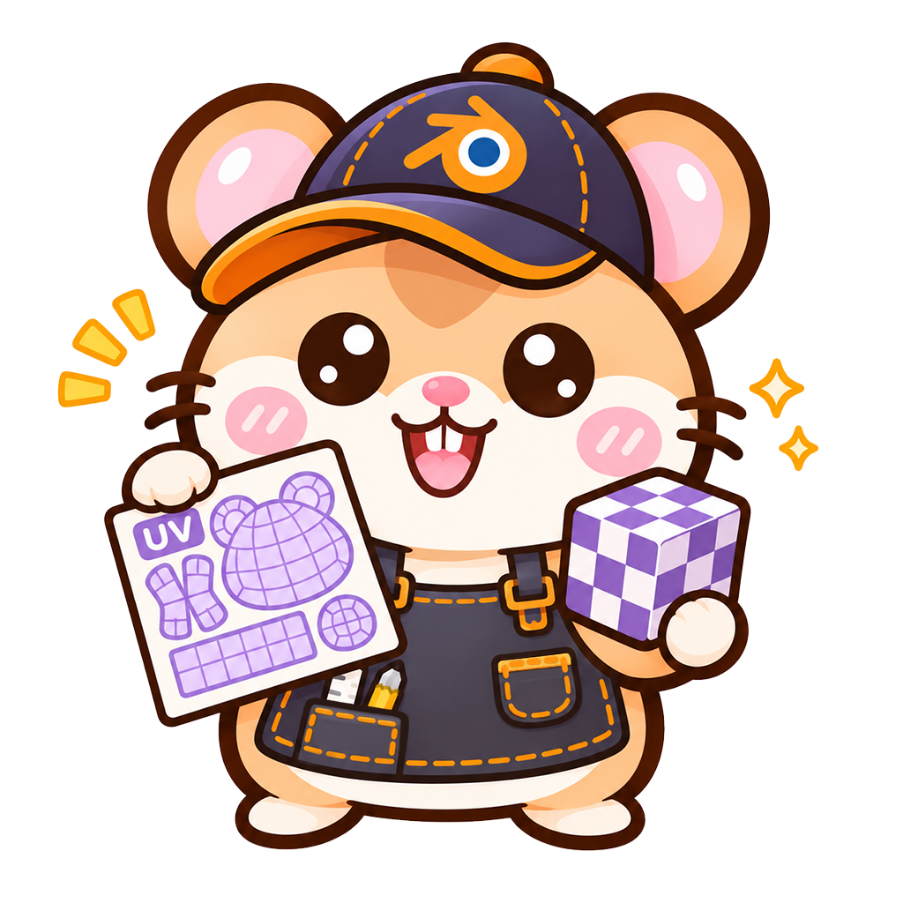
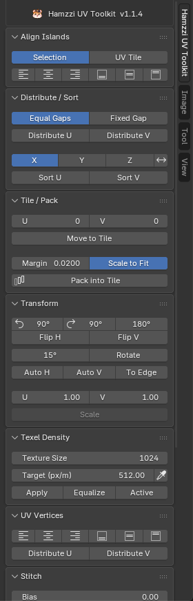

<p align="center">
  
</p>

<h1 align="center">Hamzzi UV Toolkit</h1>

<p align="center">A Blender add-on for tidying UVs you have already unwrapped</p>

<p align="center"><a href="README.md">한국어</a> | <b>English</b> | <a href="README.ja.md">日本語</a></p>

A set of tools for UVs that are already unwrapped. From sidebar buttons you can align islands and pack them into a tile, stitch seams, relax stretched UVs and match texel density. It does not unwrap UVs for you.

- Blender 4.2 or later (tested on 5.2; not run on earlier versions)
- Made by StudyingHamzzi
- Details: [User guide](docs/GUIDE.en.md) ([한국어](docs/GUIDE.md), [日本語](docs/GUIDE.ja.md))

## Screenshots

With a mesh in Edit Mode, a **Hamzzi UV Toolkit** tab appears in the sidebar (N key) of the 3D Viewport and the UV Editor.

<table>
  <tr>
    <td valign="top"></td>
    <td valign="top"><br><sub>Scattered islands gathered into the tile with one click of Pack into Tile</sub></td>
  </tr>
</table>

## Features

| Panel | What it does |
|---|---|
| Align Islands | Align islands to an edge or the center (reference: the selection or the 0–1 tile) |
| Distribute / Sort | Space islands evenly, or line them up in a row (or column) in 3D position order |
| Tile / Pack | Move to a UDIM tile, pack into a tile in rows (Margin, Scale to Fit) |
| Transform | Rotate (90°, 180°, any angle), flip, auto-orient, align selected edges to an axis, scale U and V, show faces with flipped UVs in red |
| Texel Density | Measure density, apply a target value, average it across islands, match the active face's density |
| UV Vertices | Align and distribute selected UV vertices, straighten a single edge chain (Straighten) |
| Stitch | Attach selected UV edges to the same edge on the neighboring island. The ends are matched even if the two edges differ in shape. Detach Selected does the opposite and splits an island along the selected edges |
| Unstretch | Recompute stretched UVs closer to the proportions of the 3D surface, toggle the stretch display |
| Connected Edges | Show in blue where the selected vertices, edges or faces connect on other islands |

## Installation

1. Download `HamzziUVToolkit.zip` from the repository's **Releases**. Do not unzip it.
2. In Blender, open Edit → Preferences → Get Extensions.
3. Open the arrow menu at the top right, choose **Install from Disk** and select the zip.
4. When it finishes, make sure the add-on is enabled.

> The Download ZIP option under the green Code button is the whole repository, so it cannot be installed as is. The add-on itself is the `HamzziUVToolkit/` folder.

<table>
  <tr>
    <td></td>
    <td valign="middle"><b>To update</b>, install the new zip the same way. If the panels still look like the old version, restart Blender.</td>
  </tr>
</table>

## Quick start

1. Select a mesh and press Tab to enter Edit Mode.
2. Open a UV Editor, press N to show the sidebar and click the **Hamzzi UV Toolkit** tab.
3. Island tools apply to the selected islands, or to all visible islands if nothing is selected. Every tool can be undone with Ctrl+Z.

For example, to tidy scattered islands, check that U is 0 and V is 0 under **Tile / Pack** and click **Pack into Tile**. The remaining tools and worked examples are in the [User guide](docs/GUIDE.en.md).

## Known limitations

- Stitch works only on the edges you select. It does not search for nearby edges to join.
- Unstretch is applied once to the selection, not as a brush.
- There is no feature to force shapes that cannot be flattened, such as a sphere.
- Pack into Tile places islands by their bounding boxes and does not rotate them. For a tighter fit of complex shapes, Blender's Pack Islands packs more densely.
- Connected Edges skips drawing when the faces in Edit Mode exceed the Face Limit (10,000 by default) and shows a notice in the UV Editor.
- Button names in the panels are in English.

## Bugs and questions

Please post questions, bug reports and feature requests on [Issues](https://github.com/STmagi20/HamzziUVWs/issues). For a bug, it helps if you include your Blender version, which button you pressed, and any warning shown on screen. More details are in the [User guide](docs/GUIDE.en.md#bugs-and-questions).

## Development

All files used by the add-on are in the `HamzziUVToolkit/` folder.

| Path | Contents |
|---|---|
| `HamzziUVToolkit/__init__.py` | Registration and unregistration |
| `HamzziUVToolkit/blender_manifest.toml` | Extension info and version |
| `HamzziUVToolkit/info.py` | Name, author, version |
| `HamzziUVToolkit/icons.py`, `HamzziUVToolkit/images/` | The small logo before panel names (`logo.png`) and the full-body picture in About (`mascot.png`). The add-on works without them |
| `HamzziUVToolkit/core.py` | UV data access: edit objects, selection checks, islands |
| `HamzziUVToolkit/properties.py` | Settings shown in the panels |
| `HamzziUVToolkit/operators/` | Operators per tool (`islands`, `density`, `elements`, `stitch`, `relax`) |
| `HamzziUVToolkit/overlay.py` | Connected-edge and flipped-face display in the UV Editor |
| `HamzziUVToolkit/ui.py` | Sidebar panels |
| `HamzziUVToolkit/menus.py` | UV menu entry and the empty shortcut slots for Stitch and Detach |
| `README.en.md`, `README.ja.md` | English and Japanese versions of this README |
| `docs/GUIDE.md`, `docs/GUIDE.en.md`, `docs/GUIDE.ja.md`, `docs/images/` | User guides and pictures (not included in the install zip) |
| `tests/` | Automated tests (not included in the install zip) |

The version is written only in `blender_manifest.toml`. The version shown in the panel is read from that file.

Tests run in background Blender. If all pass, the exit code is 0. Give part of a file name (for example `orient`) after `--` to run only those tests.

```bash
blender --background --factory-startup --python tests/run_tests.py
```

The background session has no UV Editor, so the tests cannot check how Relax actually behaves or what is drawn on screen. Check those two in a Blender with a UV Editor open.

Build the install zip after committing, with the command below. It packs only the folder's contents so that `blender_manifest.toml` sits at the top of the zip.

```bash
git archive --format=zip -o HamzziUVToolkit.zip HEAD:HamzziUVToolkit
```

## License

GPL-3.0-or-later. The full text is in [LICENSE](LICENSE).

Copyright (C) 2026 StudyingHamzzi
