# Hamzzi UV Toolkit User Guide

[한국어](GUIDE.md) | **English** | [日本語](GUIDE.ja.md)

Hamzzi UV Toolkit is a Blender add-on for tidying UVs you have already unwrapped. Its sidebar buttons align and arrange islands, stitch seams, relax stretched UVs and even out texel density. It does not unwrap UVs from scratch.

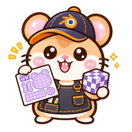

## Contents

1. [Installation](#installation)
2. [Getting started](#getting-started)
3. [Features at a glance](#features-at-a-glance)
4. [Panel reference](#panel-reference)
   - [Align Islands](#align-islands)
   - [Distribute / Sort](#distribute--sort)
   - [Tile / Pack](#tile--pack)
   - [Transform](#transform)
   - [Texel Density](#texel-density)
   - [UV Vertices](#uv-vertices)
   - [Stitch](#stitch)
   - [Unstretch](#unstretch)
   - [Connected Edges](#connected-edges)
   - [About](#about)
   - [Menu and shortcuts](#menu-and-shortcuts)
5. [Examples](#examples)
6. [Warnings and troubleshooting](#warnings-and-troubleshooting)
7. [Bugs and questions](#bugs-and-questions)
8. [Known limitations](#known-limitations)

## Installation

Blender 4.2 or newer is required. It was tested on 5.2; older versions have not been tried.

1. Download `HamzziUVToolkit.zip` from the repository's Releases. Do not unzip it.
2. In Blender, open Edit → Preferences → Get Extensions.
3. Open the arrow menu at the top right, choose **Install from Disk** and select the zip.
4. Check in the Add-ons list that Hamzzi UV Toolkit is enabled.

To update, install the new zip the same way. If the panels still look old, restart Blender.

## Getting started

1. Select a mesh object and press Tab to enter Edit Mode.
2. Press N in the 3D Viewport or the UV Editor to open the sidebar.
3. Click the **Hamzzi UV Toolkit** tab.

> This add-on tidies UVs that are already unwrapped. On a mesh without a UV map it shows a warning and changes nothing, so unwrap first (UV → Unwrap, Smart UV Project, etc.).

- Click a panel title to collapse or expand it. Connected Edges and About start collapsed.
- The panels only appear in Edit Mode. The same panels exist in both the 3D Viewport and the UV Editor. To see results right away, keep a UV Editor open next to it.
- For icon-only buttons, hover the mouse over them to see a description.

 

## Features at a glance

See [Panel reference](#panel-reference) for details.

| Task | Panel |
|---|---|
| Align islands to an edge or the center | Align Islands |
| Space islands evenly | Distribute / Sort (Distribute U / V) |
| Line islands up in the order of their 3D position | Distribute / Sort (Sort U / V) |
| Arrange scattered islands inside a tile | Tile / Pack (Pack into Tile) |
| Move islands to another UDIM tile | Tile / Pack (Move to Tile) |
| Rotate, flip, straighten tilted islands | Transform |
| Unify the resolution (texel density) of islands | Texel Density |
| Line up crooked UV edges | UV Vertices |
| Join split seams | Stitch |
| Cut an island apart along selected edges | Detach Selected in the Stitch panel |
| Relax stretched or squashed UVs | Unstretch |
| Find faces that are placed backwards (flipped) in UV | Transform (Show Flipped) |
| See where the matching side of a selected edge is | Connected Edges |
| Run tools from the UV menu or a shortcut instead of the sidebar | [Menu and shortcuts](#menu-and-shortcuts) |

## Panel reference

### Align Islands

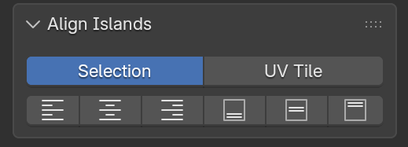

Aligns islands to an edge or to the center. Only positions change, not shapes.

1. Choose the reference with the two buttons at the top (Selection, UV Tile).
2. Press an icon button.

| Reference | Behavior |
|---|---|
| Selection | Aligns to the edges of the box that surrounds all the islands. |
| UV Tile | Aligns to the edges of the 0–1 tile that contains the center of that box. |

The six buttons work as follows, from left to right. Edges and centers follow the reference chosen above (Selection or UV Tile).

| Button | Behavior |
|---|---|
|  | Aligns to the left edge. |
|  | Aligns to the horizontal center. |
|  | Aligns to the right edge. |
|  | Aligns to the bottom edge. |
|  | Aligns to the vertical center. |
|  | Aligns to the top edge. |

To put one island in the exact middle of a tile, choose UV Tile as the reference and press  and  one after the other.

### Distribute / Sort

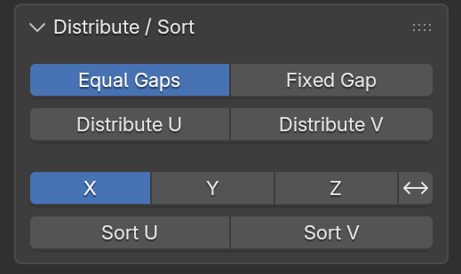

**Distribute U / V** lines islands up horizontally (U) or vertically (V) with even gaps. It needs two or more islands. They are arranged in their current order (left to right, or bottom to top), and the first island stays where it is.

| Setting | Behavior |
|---|---|
| Equal Gaps | Keeps both ends where they are and divides the space between them equally. The total width does not change. |
| Fixed Gap | Places the islands one after another, starting from the first, with the Gap value between them. The Gap field appears when Fixed Gap is chosen; the default is 0.01. A negative value makes them overlap. |

**Sort U / Sort V** places islands in one row (U) or one column (V) in the order of their **position in 3D space**. Use it when parts that are close together in 3D should also be close in UV. It needs two or more islands.

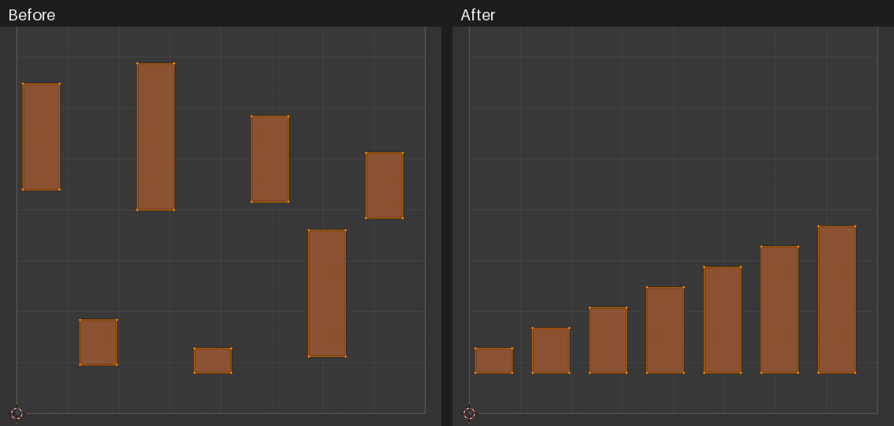

| Setting | Behavior |
|---|---|
| X / Y / Z | Chooses the 3D axis that decides the order. Islands with smaller values come first (left or bottom). |
| ↔ button right of X / Y / Z | When on, reverses the order. |
| Sort U | Places the islands in a horizontal row and aligns their bottom edges. |
| Sort V | Places the islands in a vertical column and aligns their left edges. |

- The order is decided by the center of each island's faces (in world coordinates). Even if an object has been moved or rotated, what you see on screen is what counts. When several objects are edited together, all islands are mixed into one row regardless of object.
- Gaps follow the same setting as Distribute (Equal Gaps, Fixed Gap). Equal Gaps divides the gaps evenly within the width the islands originally took up, without letting them overlap.
- Islands are not scaled or rotated. Putting them all in a row can push them outside the tile; to fit them into a tile, follow up with Pack into Tile.
- Right after pressing Distribute or Sort, you can change the gap mode and Gap, or Sort's Order By and Reverse, in the Adjust Last Operation panel and apply again. The settings in the sidebar panel do not change.

### Tile / Pack

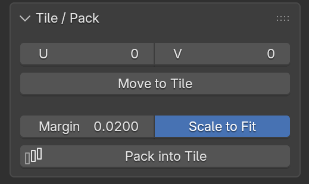

The **U, V** at the top is the tile number used by both Move to Tile and Pack into Tile. The default is U 0, V 0, which is the default square (the 0–1 tile) shown in the UV Editor.

| U, V | Position |
|---|---|
| 0, 0 | The default 0–1 square |
| 1, 0 | Right next to the default square |
| 0, 1 | Above the default square |

If the arranged islands ended up outside the square, first check that U, V is 0, 0.

**Move to Tile** moves islands to the UDIM tile given by U, V. Their position inside the tile stays the same.

- U 0, V 0 is the default 0–1 tile (1001). U 1, V 0 is 1002 and U 0, V 1 is 1011.
- The tile an island is currently in is decided by its center.
- Right after pressing it, you can change U, V in the Adjust Last Operation panel to move to a different tile. The U, V in the Tile / Pack panel does not change.

**Pack into Tile** automatically arranges scattered islands in rows inside the tile given by U, V. It starts at the bottom left of the tile, fills to the right, and moves up to the next row when a row is full.

| Setting | Behavior |
|---|---|
| Margin | The gap left between islands and along the tile border. The unit is UV (one tile = 1); 0 makes them touch. The maximum is 0.25. |
| Scale to Fit (on) | Scales all islands by the same factor, up or down, so they fill the tile as much as possible. |
| Scale to Fit (off) | Leaves sizes alone and only moves islands. If they do not all fit in the tile, it shows a warning and changes nothing. |

- **How Margin and Scale to Fit relate**: Margin is only used by Pack into Tile. Scale to Fit decides how the islands are fitted while keeping that gap.
  - When on, the Margin is always kept, even if the islands have to be resized. The usable area is `1 − 2×Margin`, so a larger Margin makes the islands smaller (at 0.25 only the central half of the tile is used).
  - When off, sizes are never touched, so if there is not enough room because of the Margin, you only get a warning and nothing changes.
  - Even when on, if the Margin is so large that the gaps alone fill the tile (for example Margin 0.25 with 10 islands), a warning appears. Lower the Margin. 0.005–0.02 is usually enough.
- Right after pressing Pack into Tile, you can fine-tune Margin, Scale to Fit and U, V while watching the result in the adjust panel at the bottom left of Blender (or Edit → Adjust Last Operation). The panel settings do not change, and each press starts again from the panel values.
- All islands get the same scale, so the ratio of texel densities between islands does not change.
- Islands are not rotated. Standing tilted islands upright first with Auto H / Auto V leaves fewer gaps.
- Tall islands are placed first; for the same height, the one further left comes first.
- Placement is based on each island's bounding box. For tighter packing of complex shapes, Blender's own Pack Islands is better.

### Transform

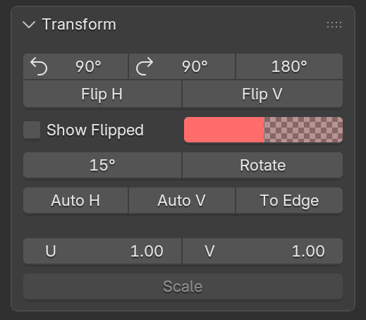

Rotating, flipping and scaling use each island's own center (the middle of the box surrounding the island).

| Button | Behavior |
|---|---|
| ↺ 90° / ↻ 90° / 180° | Rotates 90° counterclockwise, 90° clockwise or 180°. |
| Flip H / Flip V | Flips left-right or up-down. |
| Show Flipped + color field | Paints flipped faces in the UV Editor. Off by default. |
| Angle field + Rotate | Rotates by the angle you type. Positive is counterclockwise. |
| Auto H / Auto V | Rotates the island to the angle where its surrounding box is smallest, then turns the long side horizontal (H) or vertical (V). |
| To Edge | Rotates the island so the selected UV edge lies along the nearest horizontal or vertical axis. |

- Auto H / V calculates exactly the angle at which the island's surrounding box is smallest. Use it to stand tilted islands upright.
- To Edge needs an edge selected inside the island first. If several edges are selected, the longest edge of each island is used as its reference.
- Flipping makes a texture look as if seen in a mirror. Be careful on faces with text or logos.
- Right after pressing the angle field + Rotate, you can change Angle in the Adjust Last Operation panel and rotate again. The angle field in the sidebar does not change.

**Flipped face display**: With Show Flipped on, flipped faces are painted red in the UV Editor. A flipped face is one where the texture looks mirrored left-to-right when you view the model from outside. A face whose normal points inward but whose texture looks correct from outside does not count as flipped. If the painted faces make up a whole island, Flip H / Flip V can fix it.

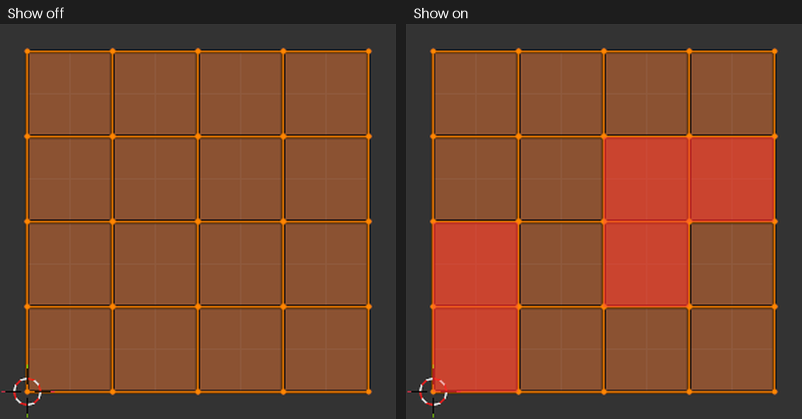

- It only shows them; it does not select or fix anything.
- On symmetric models one side is sometimes deliberately overlapped as a mirror image to save texture space. Flipped faces are not always mistakes, so check whether it is intended before fixing.
- Only visible faces are checked. Hidden faces are not included, and with UV Sync off only faces selected in the 3D Viewport are checked.
- Faces joined by edges are treated as one piece, and the outside is decided by the volume the piece encloses. Models with many holes can get the outside wrong. For a single flat sheet, the side the normal points to is treated as the outside.
- Faces whose UV area is nearly zero are not checked because their direction is unknown.
- If the number of faces exceeds Face Limit (the same value as the Connected Edges setting), the display is skipped and a notice appears at the top left of the UV Editor.

**Scale**: Type scale factors in the U, V fields at the bottom of the panel and press **Scale** to resize each island around its own center.

- U 2, V 2 doubles the size; U 0.5, V 0.5 halves it.
- Different values for U and V stretch in one direction only, so the texture looks squashed.
- If both values are 1 there is nothing to change and the button is disabled.
- The scale is applied again each time you press it.
- Right after pressing, you can change the U, V scale in the Adjust Last Operation panel and apply again. This recalculates from the size before pressing, so it does not compound.

### Texel Density

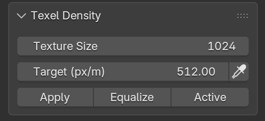

Texel density is how many texture pixels fit in 1 m of 3D surface (px/m). Islands need the same density for the texture resolution to look even.

1. Type the number of pixels on one side of the texture in **Texture Size**.
2. Select the island to use as the reference and press the eyedropper button. The measured average is filled into **Target (px/m)**, and the result appears below.
3. Select the islands whose density you want to match and press Apply, Equalize or Active.

| Button | Behavior |
|---|---|
| Apply | Sets the selected islands to the Target value. |
| Equalize | Sets the selected islands to their average density. The overall size stays about the same. |
| Active | Matches the density of the island containing the active face (the last face you clicked). |

Right after pressing Apply, you can fine-tune Texture Size and Target (px/m) in the adjust panel at the bottom left of Blender (or Edit → Adjust Last Operation) while watching the result. The sidebar settings do not change, and each press starts again from the panel values. Equalize and Active use the density measured in UV, so there is nothing to adjust.

The measurement is shown in two forms.

- `Measured: 512.0 px/m (4 islands, uniform)`: all densities are equal.
- `Measured: 210.5 - 890.2 px/m (4 islands)`: the lowest and highest values. A big difference means you need Equalize or Apply.

Good to know:

- Texture Size is only used to convert units; changing it does not move any UV.
- Density takes object scale into account, so when matching several objects it uses real size.
- Islands are only resized in place, so they can overlap. Check the layout after applying.
- The eyedropper only measures and does not change UVs.

### UV Vertices

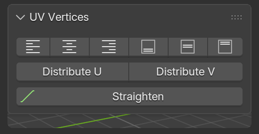

Moves only the selected UV vertices, not whole islands. Use it to line up crooked edges.

The six buttons work as follows, from left to right.

| Button | Behavior |
|---|---|
|  | Aligns the selected vertices to the leftmost one, making a vertical straight line. |
|  | Aligns the selected vertices to their average horizontal position, making a vertical straight line. |
|  | Aligns the selected vertices to the rightmost one, making a vertical straight line. |
|  | Aligns the selected vertices to the lowest one, making a horizontal straight line. |
|  | Aligns the selected vertices to their average vertical position, making a horizontal straight line. |
|  | Aligns the selected vertices to the highest one, making a horizontal straight line. |
| Distribute U / V | Keeps both end vertices and spaces the rest evenly. |
| Straighten | Puts one chain of connected UV edges on the straight line between its two end vertices. The spacing ratios between vertices stay as they were. |

- You need two or more vertices selected to align, and three or more to distribute.
- Distribute only moves in U or V, and the vertex order follows the current order.
- **Straighten** needs the selected vertices to form a single line with two ends. If the selection is a loop or has branches, it is skipped with a warning. The two end vertices do not move, and a slanted line is straightened while staying slanted. If there are several lines, each one is straightened on its own.
- To make one edge line straight, select the vertices of that line. To keep the original spacing ratios, use Straighten. For a vertical line, use  to make it straight and then Distribute V; for a horizontal line, use  and then Distribute U to even out the spacing.

### Stitch

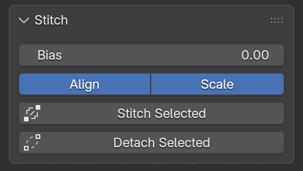

Joins the selected UV edge to the same edge on the island across the seam.

1. Select the UV edges you want to join. You can select several at once.
2. Set Bias and the options.
3. Press **Stitch Selected**.

Right after pressing Stitch Selected, you can fine-tune Bias, Align Clusters and Scale Clusters in the adjust panel at the bottom left of Blender (or Edit → Adjust Last Operation) while watching the result. The sidebar settings do not change, and each press starts again from the panel values.

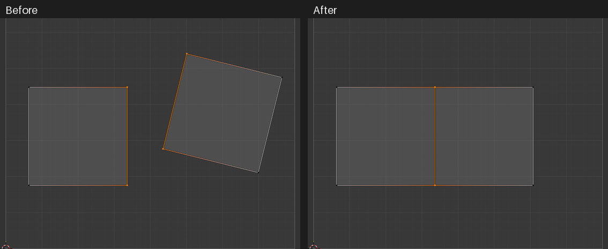

| Option | Behavior |
|---|---|
| Bias 0 | The island on the selected side stays and the neighbor moves to join it. |
| Bias 1 | The neighbor stays and the island on the selected side moves to join it. |
| Bias 0.5 | Both islands move halfway and meet in the middle. |
| Align (Align Clusters) | Rotates the moving island so the edge directions match. |
| Scale (Scale Clusters) | Scales the moving island so the edge lengths match. |

Usually you keep both Align and Scale on. Even if you turn them off, or the islands have different shapes (not clean rectangles, squashed faces, and so on), the two ends of the seam are joined exactly at the end.

- With Align and Scale on: the island is rotated and scaled first, and only the small remaining difference is joined at the ends. The island changes shape the least.
- With them off: the island only moves, and the shape near the seam stretches or bends as the ends are joined.

**Which side is "selected"**

- If only one side of an edge is selected, the island on that side is the selected one.
- If both sides are selected (for example when you selected the edge in the 3D Viewport), the island holding the active face counts as selected. Click a face of the island you want to keep in place last.

**Good to know**

- If you select several edges between the same two islands, the position that fits all of them best is calculated at once.
- When joining three or more islands in a chain, the islands already joined move together as one piece.
- If the neighbor island is flipped, it is flipped automatically before joining.
- When islands form a ring, the last edge does not move the islands again; only its end points are joined. The area around it can get pulled a little.
- The mesh's seam marks stay as they were after stitching.

**Detach Selected**

The opposite of Stitch. It cuts an island into two or more pieces along the selected UV edges.

1. Select the UV edges that form the cutting line. The line has to run from one border of the island to another (or to another cutting line).
2. Press **Detach Selected**.
3. Right after, set the gap between the pieces with **Gap** in the adjust panel. The default is 0.02 UV units.

- The pieces move away from the island's center by half of Gap each, so when you cut in two, both sides open by the same amount. When you cut into three or more, a piece in the middle, at the center, does not move.
- If the selected edges do not split the island in two (for example a line that does not reach the border), nothing changes and you only get a warning.
- The mesh's seam marks do not change after detaching. You can join them again with Stitch.
- If you select every vertex in an island and press it, every face is separated, so be careful.

### Unstretch

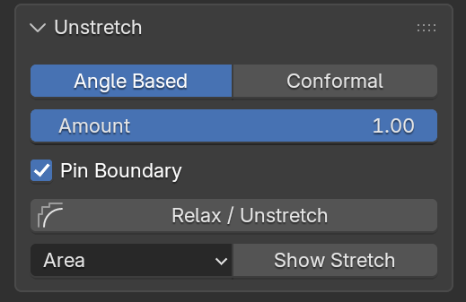

Fixes UVs where the texture looks stretched. It recalculates the positions of the selected UV vertices from the shape of the 3D surface so they come closer to the real proportions in 3D.

1. Select the UV vertices of the area you want to relax.
2. Set Method and Amount.
3. Press **Relax / Unstretch**.

Right after pressing Relax / Unstretch, you can fine-tune Method, Pin Boundary and Amount in the adjust panel at the bottom left of Blender (or Edit → Adjust Last Operation) while watching the result. The sidebar settings do not change, and each press starts again from the panel values.

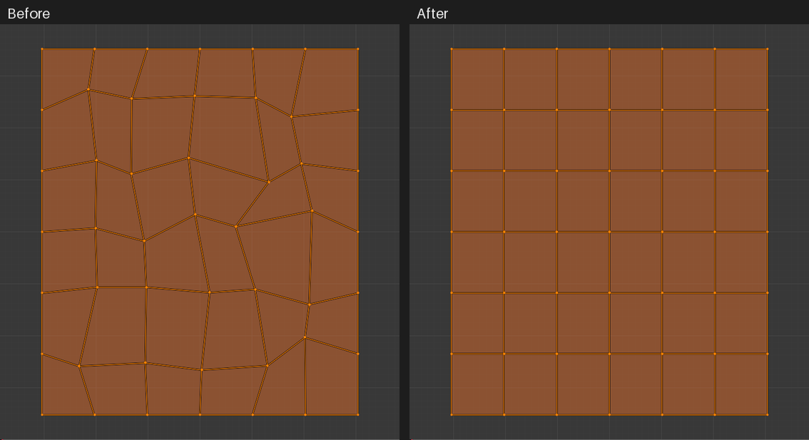

| Setting | Behavior |
|---|---|
| Angle Based | Keeps angles as much as possible. This is the safe choice in most cases. |
| Conformal | Keeps shapes but sizes may change. |
| Amount | How far to move toward the relaxed result. 1 goes all the way, 0.5 goes halfway. |
| Pin Boundary (on by default) | Leaves the island outline as it is and relaxes only the inner vertices evenly. Because the outline stays, the island's shape and position do not change and it does not overlap its neighbors. When off, all the selected vertices, including the outline, are relaxed. |

**Good to know when using Pin Boundary**

- When on, vertices on the outline do not move even if selected. If every vertex is on the outline (for example an island with a single face), nothing changes and you only get a warning.
- If the outline is already distorted compared with the 3D surface proportions, run with Pin Boundary off. With it on, the outline is fixed and the inside is fitted to that outline, which can make the distortion worse.
- When off, the island's position, size and orientation stay almost the same and only its shape relaxes. The shape can change a lot, though, and overlap neighboring islands. Conformal changes the most, so it is not recommended.

**Other notes**

- Pin the vertices you want to keep still with P.
- This is not a brush you rub with; it calculates once each time you press the button. To relax gradually, lower Amount and press several times.

**Show Stretch** turns the stretch display in the UV Editor on and off. In the list next to it, choose whether to see Area (area distortion) or Angle (angle distortion). The closer to blue, the less distortion. At least one UV Editor has to be open.

### Connected Edges

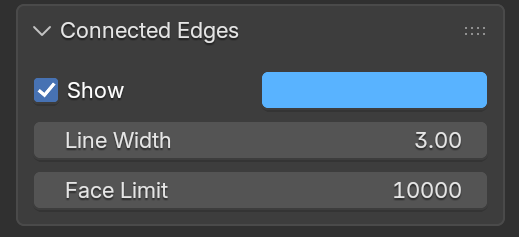

Shows in color in the UV Editor where the selected points, edges and faces connect to on other islands. Use it to find the opposite side of a seam.

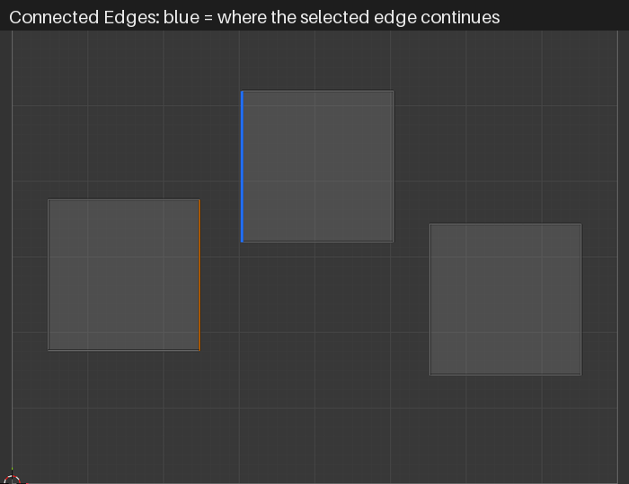

| Setting | Behavior |
|---|---|
| Show | Turns the display on and off. On by default. The color field next to it changes the display color. |
| Line Width | Line thickness. Points are drawn a little larger than this. |
| Face Limit | If the number of faces in Edit Mode exceeds this value, the display is skipped. The default is 10,000. |

- In vertex select mode it shows points; in edge and face select modes it shows lines.
- It is not shown if the opposite side is already at the same position, or if the opposite side is also selected.
- While moving, rotating or scaling, the display disappears for a moment and comes back when you let go of the mouse.
- If the UV Editor gets slow with a mesh that has many faces, lower Face Limit or turn the display off.
- If the display is skipped because the face count exceeds Face Limit, a notice at the top left of the UV Editor says which display is missing.

### About

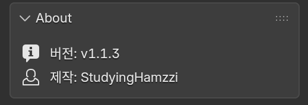

Shows the version and the author. (The labels in the panel are in Korean: "버전" = version, "제작" = author.)

| Item | Content |
|---|---|
| Author | Studying Hamzzi |
| Help | Claude (Anthropic) |
| Images | AI generated |
| License | GPL-3.0-or-later (source code). The full text is in the repository's [LICENSE](../LICENSE). |

### Menu and shortcuts

**UV menu**: At the bottom of the UV Editor's UV menu there is a **Hamzzi UV Toolkit** entry. Almost every sidebar button (align, distribute, tile, rotate, density, Straighten, Stitch, Detach, Relax) can also be used from the menu. Tools that need values run with the values set in the sidebar.

**How to open the UV menu**

1. Put the mesh object in Edit Mode and open a UV Editor (the UV Editing workspace is convenient).
2. Open the **UV** menu at the top of the UV Editor.
3. Hover over **Hamzzi UV Toolkit** at the bottom of the menu. The list of tools opens in the order Islands, Transform, Texel Density, UV Vertices, Seams, Relax / Unstretch.

**Shortcuts**: No key is assigned by default. Only Stitch Selected and Detach Selected are registered with an empty key slot. So that they do not collide with existing keys, they start out empty; assign the keys you like.

*Assign in Preferences (recommended)*

1. Open Edit → Preferences → Keymap.
2. Set the search mode to Name and search for `Stitch` or `Detach`.
3. Under UV Editor and Mesh, Stitch Selected and Detach Selected appear as `None`.
4. Click the key field and press the key combination you want. To use it in both the UV Editor and the 3D Viewport (Edit Mode), set the same key in both UV Editor and Mesh.
5. Preferences are saved automatically. If auto-save is off, press Save Preferences.

*Assign directly from the UV menu*

1. In UV menu → Hamzzi UV Toolkit, hover over **Stitch Selected** and right-click.
2. Choose **Assign Shortcut** and press the key you want.
3. This only assigns it in the UV Editor. To use it in the 3D Viewport too, also set the Mesh entry in Preferences as above.

- If a key is already used, Preferences shows a conflict mark. Pick a combination that does not conflict.
- To remove an assigned key, click the X button next to the key field.
- The assigned shortcut is shown to the right of the menu item.

## Examples

### Tidying an atlas

1. In the UV Editor, press A to select all the islands to tidy.
2. In Transform, press **Auto H** to stand the islands upright.
3. In Texel Density, type the Texture Size and press **Equalize** to unify the density.
4. In Tile / Pack, check U 0, V 0, set a small Margin and press **Pack into Tile** to arrange them in rows inside the tile.
5. To adjust only some of them, select those islands and refine them with Align Islands and **Distribute U / V**.

### Joining a split seam

1. In the UV Editor, select the border edges you want to join.
2. Use the blue display to check which island holds the matching edge.
3. In Stitch, with Bias 0 and Align and Scale on, press **Stitch Selected**.
4. Check that the seam fits together. The joined islands become one, and the end points of the seam are at the same position.

### Cutting an island apart for separate use

1. Select the UV edges that make the cutting line, from one border of the island to another.
2. In the Stitch panel, press **Detach Selected**.
3. In the adjust panel at the bottom left (Adjust Last Operation), set the gap between pieces with **Gap**.
4. To join them again, select the cut edges and press **Stitch Selected**.

### Straightening crooked edges

1. Select the UV vertices of the edge you want to straighten.
2. In UV Vertices, press  to put the vertices on a horizontal line.
3. Press **Distribute U** to even out the spacing.
4. Once the outline is right, select the whole island and press **Relax / Unstretch** in Unstretch to relax the inside evenly.

For a vertical edge, use  and **Distribute V**.

### Sorting in 3D model order

1. Select the islands to sort (all of them if nothing is selected).
2. In Distribute / Sort, choose the reference axis (X, Y, Z).
3. Press **Sort U** (horizontal) or **Sort V** (vertical).
4. To fit them in a tile, press **Pack into Tile** in Tile / Pack afterward.

### Matching texel density across several objects

1. Select all the objects whose density you want to match and enter Edit Mode together.
2. Click one face to use as the reference. It becomes the active face.
3. Press A to select everything.
4. In Texel Density, press **Active**. All islands are matched to the density of the island that holds the reference face.

### Splitting into UDIM tiles

1. Select the islands to move.
2. In Tile / Pack, type the tile number in U, V.
3. Press **Move to Tile**.

## Warnings and troubleshooting

These are the messages that appear in the status bar at the bottom of the screen (and in the Info editor) when you run a tool.

| Message | Meaning and fix |
|---|---|
| No UV islands found | There are no islands to process. If the UV Sync Selection button in the UV Editor header (the two-arrows icon) is off, only faces selected in the 3D Viewport are shown in the UV Editor. In that case, select faces in the 3D Viewport. Every tool that works on islands gives this same warning. |
| No UV map on (object name) - unwrap the mesh first (UV > Unwrap) | That object has no UV map (a mesh that was never unwrapped). Unwrap first with UV → Unwrap or Smart UV Project in Blender. Nothing changes when this warning appears. |
| Skipped objects without a UV map: (object name) | When editing several objects together, objects without a UV map were skipped and only the rest were processed. |
| Select at least two islands | Distribute and Sort need two or more islands. |
| The islands do not fit in one tile - enable Scale to Fit or lower the margin | Scale to Fit is off and the islands do not all fit in the tile. Turn on Scale to Fit or lower Margin. |
| The margin is too large for this many islands - lower the margin | Even with Scale to Fit on, the Margin alone fills the tile. Lower Margin. |
| Select a UV edge inside the island | To Edge needs a UV edge selected inside the island as its reference. |
| No measurable islands | Only islands with zero area exist. Check whether the UVs have collapsed to one point. |
| Target (px/m) must be above zero | Enter a value greater than 0 in Target. |
| No active face - select a face first | To use Active, click a face to make it the active face. |
| Select at least two UV vertices | You need two or more vertices selected to align. |
| Select at least three UV vertices | You need three or more vertices selected to distribute. |
| Select UV edges that have a matching edge on another island | The selected edge has no match on another island. It is not a seam, or it is already joined. |
| Select a chain of connected UV edges to straighten | Straighten needs one chain of connected UV edges. Select edges so the vertices form a single line with two ends. |
| Skipped N selection(s) that are loops or branch; select a single open chain | A notice that selections that are loops or have branches were skipped. Select only a single open line. |
| Select UV edges that cut an island in two (the cut has to reach the border of the island) | Detach Selected needs a line that splits the island in two. Select edges so that the line reaches the island's border. |
| Select the UV vertices you want to relax | Select the UV vertices you want to relax. |
| Only outline vertices are selected - select inner vertices or turn off Pin Boundary | All the selected vertices are on the island outline. Select inner vertices or turn off Pin Boundary. |
| Relax could not solve N island(s): they have no open UV border; they were left unchanged | The island has no open UV border (every edge is joined). It cannot be relaxed and was left as it is. Add seams to split the UV in at least one place so there is an open border, then try again. |
| Relax could not solve N island(s); they were left unchanged | Islands where relaxing failed were left as they are. Reduce the selection or split the island and try again. |
| Relax failed | Blender's unwrap calculation failed. Reduce the selection and try again. |
| No 3D Viewport is open, so the result may be distorted - open one in any window and run Relax again | No window had any editor other than UV Editors, so Blender's unwrap had to run inside the UV Editor, where it can distort the result. Open a 3D Viewport in any window, press Ctrl+Z and run Relax again. |
| Could not restore selection / seams / pins on (object name) - press Ctrl+Z | After Relax finished, the selection, seams or pins of that object could not be put back. Press Ctrl+Z to undo and try again. |
| No UV editor is open | Show Stretch needs a UV Editor to be open. |

| Symptom | What to check |
|---|---|
| The Hamzzi UV Toolkit tab is missing | Check that the mesh is in Edit Mode and that the add-on is enabled in Preferences. |
| The hamster picture in the panel does not show | Check that the `images` folder in the install zip contains `logo.png` and `mascot.png`. The features work without the pictures. |
| A button is gray | Check that there is a mesh object in Edit Mode. The Scale button is disabled when both U and V scale are 1. |
| It moves more than I selected | Island tools move the whole island a vertex belongs to, even if you select only one vertex. With nothing selected they apply to all visible islands. |
| Islands overlap after matching density | This is normal. Matching density makes islands grow or shrink in place. Arrange them again with Pack into Tile or Blender's Pack Islands. |
| Islands overlap their neighbors after Relax | This can happen when you relax with Pin Boundary off. With Pin Boundary on, the outline stays and they do not overlap. |
| Flipped faces are not painted | Check that Show Flipped in the Transform panel is on, that a UV Editor is open and that the face count does not exceed Face Limit. Hidden faces are not checked. |
| Connected Edges is not shown | Check that the display is on and the face count does not exceed Face Limit. It is not shown if the opposite side of the selected edge is already joined. |
| The UV Editor is slow when dragging, or Blender freezes | Turn off Show in Connected Edges and try again. If it continues, see [Bugs and questions](#bugs-and-questions) and tell us in the repository's Issues. |
| The panels look like the old version | Install the new zip and restart Blender. |

## Bugs and questions

If you run into a bug while using the add-on, or have a question or a feature request, leave it in the repository's [Issues](https://github.com/STmagi20/HamzziUVWs/issues).

First look for whether the same thing has already been posted. When you post a new one, including the following makes it easier to find the cause.

- **Blender version and add-on version**: you can check the add-on version in the About panel.
- **What you did**: which button in which panel you pressed, what was selected at the time (points, edges, faces, islands), and whether UV Sync was on.
- **What happened**: the result you expected and the actual result, and the warning text shown in the status bar at the bottom of the screen, exactly as it appears.
- **Screenshots**: before and after pictures of the UV Editor help a lot.
- If the problem repeats, describe the steps that make it appear again.

## Known limitations

- Stitch only works on the selected edges; it does not search for nearby edges automatically.
- Unstretch is applied once to the selected area, not like a brush.
- There is no feature yet to force-flatten shapes that cannot be flattened, such as a sphere.
- Pack into Tile arranges islands by their bounding boxes and does not rotate them.
- Changing the density does not rearrange the islands automatically.
- Connected Edges skips the display when the face count exceeds Face Limit.
- Button names in the panels are in English.
