# Hamzzi UV Toolkit 使用ガイド

[한국어](GUIDE.md) | [English](GUIDE.en.md) | **日本語**

Hamzzi UV Toolkit は、すでに展開した UV を整える Blender アドオンです。サイドバーのボタンで、アイランドの整列と配置、継ぎ目の縫合、引き伸ばされた UV のリラックス、テクセル密度の統一ができます。UV を新しく展開する機能はありません。

## 目次

1. [インストール](#インストール)
2. [はじめに](#はじめに)
3. [機能一覧](#機能一覧)
4. [パネル別の使い方](#パネル別の使い方)
   - [Align Islands](#align-islands)
   - [Distribute / Sort](#distribute--sort)
   - [Tile / Pack](#tile--pack)
   - [Transform](#transform)
   - [Texel Density](#texel-density)
   - [UV Vertices](#uv-vertices)
   - [Stitch](#stitch)
   - [Unstretch](#unstretch)
   - [Connected Edges](#connected-edges)
   - [About](#about)
   - [メニューとショートカット](#メニューとショートカット)
5. [作業例](#作業例)
6. [警告メッセージとトラブルシューティング](#警告メッセージとトラブルシューティング)
7. [バグとお問い合わせ](#バグとお問い合わせ)
8. [既知の制限](#既知の制限)

## インストール

Blender 4.2 以上が必要です。テストは 5.2 で行い、それより古いバージョンでは実行していません。

1. リポジトリの Releases から `HamzziUVToolkit.zip` をダウンロードします。解凍はしません。
2. Blender で Edit → Preferences → Get Extensions を開きます。
3. 右上の矢印メニューから **Install from Disk** を選び、zip を選択します。
4. Add-ons の一覧で Hamzzi UV Toolkit が有効になっていることを確認します。

アップデートするときは、新しい zip を同じ方法でインストールしてください。パネルが古い表示のままの場合は、Blender を再起動します。

## はじめに

1. メッシュオブジェクトを選択し、Tab キーで Edit Mode に入ります。
2. 3D ビューポートまたは UV エディターで N キーを押し、サイドバーを開きます。
3. **Hamzzi UV Toolkit** タブをクリックします。

> このアドオンは、すでに展開した UV を整えるツールです。UV マップのないメッシュでは警告が出て何も変わらないので、先に Blender で UV を展開してください（UV → Unwrap、Smart UV Project など）。

- パネルのタイトルをクリックすると、折りたたんだり開いたりできます。Connected Edges と About は最初は折りたたまれています。
- パネルは Edit Mode でのみ表示されます。3D ビューポートと UV エディターの両方に同じパネルがあります。結果をすぐ確認するには、UV エディターを一緒に開いておくと便利です。
- アイコンだけのボタンは、マウスを乗せると説明が表示されます。

 

## 機能一覧

詳しい使い方は[パネル別の使い方](#パネル別の使い方)にあります。

| 作業 | 使うパネル |
|---|---|
| アイランドを端や中央に揃える | Align Islands |
| アイランドの間隔を均等にする | Distribute / Sort (Distribute U / V) |
| 3D 上の位置の順にアイランドを一列に並べる | Distribute / Sort (Sort U / V) |
| 散らばったアイランドをタイルの中に整理する | Tile / Pack (Pack into Tile) |
| アイランドを別の UDIM タイルへ移動する | Tile / Pack (Move to Tile) |
| 回転、反転、傾いたアイランドをまっすぐにする | Transform |
| アイランドごとに違う解像度（テクセル密度）を統一する | Texel Density |
| 曲がった UV エッジを一直線にそろえる | UV Vertices |
| 分かれた継ぎ目をくっつける | Stitch |
| くっついたアイランドを選択したエッジで切り離す | Stitch パネルの Detach Selected |
| 引き伸ばされた、つぶれた UV をほぐす | Unstretch |
| UV で裏返しに置かれた（反転した）面を探す | Transform (Show Flipped) |
| 選択したエッジの相手の位置を確認する | Connected Edges |
| サイドバーを使わず UV メニューやショートカットで実行する | [メニューとショートカット](#メニューとショートカット) |

## パネル別の使い方

### Align Islands

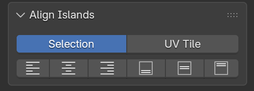

アイランドを端や中央に揃えます。形は変わらず、位置だけが動きます。

1. 一番上の 2 つのボタン（Selection、UV Tile）で基準を選びます。
2. アイコンボタンを押します。

| 基準 | 動作 |
|---|---|
| Selection | アイランド全体を囲む四角形の端に揃えます。 |
| UV Tile | その四角形の中心がある 0–1 タイルの端に揃えます。 |

6 つのボタンの動作は、左から順に次のとおりです。端と中央は、上で選んだ基準（Selection または UV Tile）に従います。

| ボタン | 動作 |
|---|---|
|  | 左端に揃えます。 |
|  | 水平方向の中央に揃えます。 |
|  | 右端に揃えます。 |
|  | 下端に揃えます。 |
| 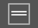 | 垂直方向の中央に揃えます。 |
|  | 上端に揃えます。 |

アイランド 1 つをタイルのちょうど真ん中に置くには、基準を UV Tile にして   ボタンを順に押します。

### Distribute / Sort

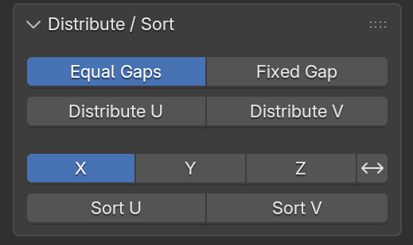

**Distribute U / V** は、アイランドの間隔を均等にしながら横（U）または縦（V）に並べます。アイランドが 2 つ以上必要です。現在の並び順（左から右、または下から上）で並べ、先頭のアイランドは動かしません。

| 設定 | 動作 |
|---|---|
| Equal Gaps | 両端はそのままにして、その間の隙間を等分します。全体の幅は変わりません。 |
| Fixed Gap | 先頭のアイランドから Gap の値だけ空けて順に置きます。Fixed Gap を選ぶと Gap 欄が表示され、初期値は 0.01 です。負の値を入れると重ねて置きます。 |

**Sort U / Sort V** は、アイランドを **3D 空間での位置の順**に、一行（U）または一列（V）に並べます。3D モデルで近い部分が UV でも近くに来るようにしたいときに使います。アイランドが 2 つ以上必要です。

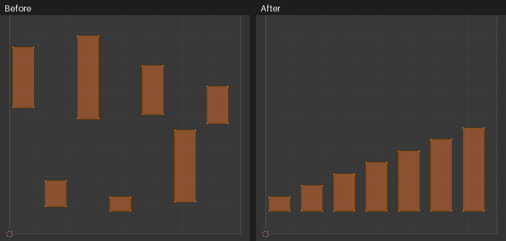

| 設定 | 動作 |
|---|---|
| X / Y / Z | 順序を決める 3D の軸を選びます。値が小さいアイランドが先（左または下）に置かれます。 |
| X / Y / Z の右の ↔ ボタン | オンにすると順序を逆にします。 |
| Sort U | 横一列に置き、下端を揃えます。 |
| Sort V | 縦一列に置き、左端を揃えます。 |

- 順序は、アイランドに属する面の中心位置（ワールド座標）で決まります。オブジェクトを動かしたり回したりしていても、画面に見えている位置が基準です。複数のオブジェクトを一緒に編集した場合は、オブジェクトに関係なく一列に混ぜて並べます。
- 間隔は Distribute と同じ設定（Equal Gaps、Fixed Gap）に従います。Equal Gaps は、最初にアイランドが占めていた幅の中で隙間を均等に分け、互いに重ならないようにします。
- アイランドの拡大縮小や回転はしません。一列に並べるとタイルの外に出ることがあるので、タイルに収めるには続けて Pack into Tile を使ってください。
- Distribute や Sort を押した直後は、調整パネル（Adjust Last Operation）で間隔の方式と Gap、Sort の Order By と Reverse を変えて、もう一度適用できます。サイドバーのパネルの設定値は変わりません。

### Tile / Pack

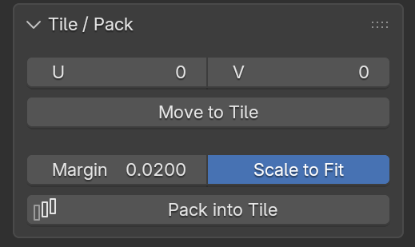

一番上の **U, V** は、Move to Tile と Pack into Tile が共通で使うタイル番号です。初期値は U 0、V 0 で、UV エディターに表示されている既定の四角形（0–1 タイル）を指します。

| U, V | 位置 |
|---|---|
| 0, 0 | 既定の 0–1 の四角形 |
| 1, 0 | 既定の四角形の右隣 |
| 0, 1 | 既定の四角形の上 |

整理したアイランドが四角形の外に置かれた場合は、まず U, V が 0, 0 になっているか確認してください。

**Move to Tile** は、アイランドを U, V で指定した UDIM タイルへ移動します。タイル内での位置は保たれます。

- U 0、V 0 は既定の 0–1 タイル（1001）です。U 1、V 0 は 1002、U 0、V 1 は 1011 です。
- アイランドが今どのタイルにあるかは、中心位置で判断します。
- 押した直後は、調整パネル（Adjust Last Operation）で U, V を変えて別のタイルへ移動できます。Tile / Pack パネルの U, V は変わりません。

**Pack into Tile** は、散らばったアイランドを U, V で指定したタイルの中に行ごとに自動配置します。タイルの左下から始めて右へ詰め、一行がいっぱいになると次の行へ上がります。

| 設定 | 動作 |
|---|---|
| Margin | アイランドの間とタイルの縁に残す隙間です。単位は UV（タイル 1 枚 = 1）で、0 なら互いに接します。最大値は 0.25 です。 |
| Scale to Fit（オン） | タイルをできるだけ大きく埋めるように、すべてのアイランドを同じ倍率で拡大または縮小します。 |
| Scale to Fit（オフ） | 大きさはそのままで、位置だけ動かします。タイルに収まらない場合は警告を出し、何も変更しません。 |

- **Margin と Scale to Fit の関係**: Margin は Pack into Tile でのみ使う設定です。Scale to Fit は、その隙間を守りながらアイランドをどう収めるかを決めます。
  - オンにしておくと、アイランドの大きさを変えてでも Margin を必ず守ります。使える領域が `1 − 2×Margin` になるので、Margin が大きいほどアイランドが小さくなります（0.25 ならタイルの中央の半分の領域だけを使います）。
  - オフにしておくと大きさには触れないので、Margin のせいで場所が足りないときは警告だけを出して何も変更しません。
  - オンのままでも、Margin が大きすぎて隙間だけでタイルが埋まる場合（例：Margin 0.25 でアイランド 10 個）は警告が出ます。Margin を小さくしてください。通常は 0.005～0.02 で十分です。
- Pack into Tile を押した直後は、Blender の左下（または Edit → Adjust Last Operation）の調整パネルで、Margin、Scale to Fit、U, V を結果を見ながら調整できます。パネルの設定値は変わらず、押すたびにパネルの値から再開します。
- すべてのアイランドに同じ倍率をかけるので、アイランド間のテクセル密度の比は変わりません。
- アイランドは回転しません。傾いたアイランドは、先に Auto H / Auto V で立てておくと隙間が減ります。
- 背の高いアイランドから置き、高さが同じなら現在位置の左側から置きます。
- アイランドを囲む四角形（バウンディングボックス）を基準に配置します。複雑な形を隙間なく詰めるには、Blender の Pack Islands のほうが密に配置できます。

### Transform

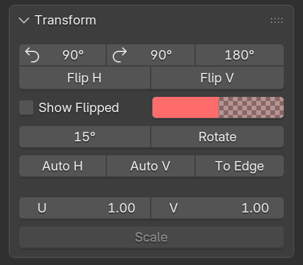

回転、反転、拡大縮小は、アイランドごとに自分の中心（アイランドを囲む四角形の真ん中）を基準にします。

| ボタン | 動作 |
|---|---|
| ↺ 90° / ↻ 90° / 180° | 反時計回りに 90°、時計回りに 90°、180° 回転します。 |
| Flip H / Flip V | 左右、上下に反転します。 |
| Show Flipped + 色欄 | 反転した面を UV エディターで色で塗ります。初期値はオフです。 |
| 角度欄 + Rotate | 欄に入れた角度だけ回転します。正の値は反時計回りです。 |
| Auto H / Auto V | アイランドを囲む四角形が最も小さくなる角度に回したあと、長い辺を横（H）または縦（V）に合わせます。 |
| To Edge | 選択した UV エッジが最も近い水平または垂直の軸に沿うように、アイランドを回します。 |

- Auto H / V は、アイランドを囲む最小の四角形になる角度を正確に計算します。斜めに置かれたアイランドをまっすぐ立てるときに使います。
- To Edge は、先にアイランドの中で基準にするエッジを選択しておく必要があります。エッジを複数選んだ場合は、アイランドごとに最も長いエッジ 1 本を基準にします。
- 反転すると、テクスチャが鏡に映ったように見えます。文字やロゴのある面では注意してください。
- 角度欄 + Rotate を押した直後は、調整パネル（Adjust Last Operation）で Angle を変えて、もう一度回せます。サイドバーの角度欄は変わりません。

**反転した面の表示**: Show Flipped をオンにすると、UV エディターで反転した面が赤で塗られます。反転した面とは、モデルを外側から見たときにテクスチャが左右反転して見える面です。面の法線が内側を向いていても、外側からテクスチャが正しく見えるなら反転とはみなしません。塗られた面がアイランド全体なら、Flip H / Flip V で直せます。

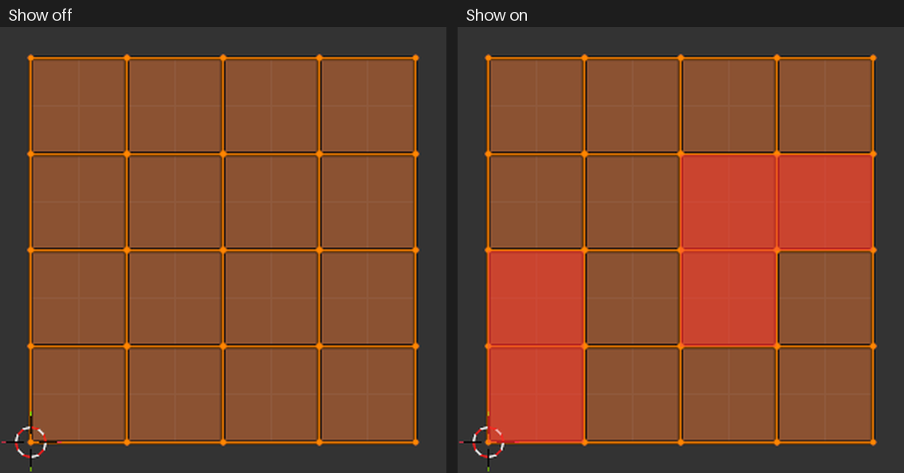

- 表示するだけで、選択や修正はしません。
- 対称モデルでは、テクスチャを節約するために片側をわざと鏡像で重ねることがあります。反転した面が常に間違いとは限らないので、意図したものか確認してから直してください。
- 画面に見えている面だけを検査します。非表示の面は含まれず、UV Sync がオフのときは 3D ビューポートで選択した面だけが対象です。
- エッジでつながった面を一つのかたまりとみなし、かたまりが囲む体積で外側を決めます。穴がたくさん開いたモデルでは外側を誤ることがあります。平らな一枚の場合は、法線が向いている側を外側とみなします。
- UV の面積がほぼ 0 の面は、向きが分からないので検査しません。
- 面の数が Face Limit（Connected Edges の設定と同じ値）を超えると、表示をスキップし、UV エディターの左上に案内文を出します。

**Scale**: パネルの下側の U, V 欄に倍率を入れて **Scale** を押すと、アイランドごとに自分の中心を基準に大きさを変えます。

- U 2、V 2 は 2 倍に拡大し、U 0.5、V 0.5 は半分に縮小します。
- U と V に違う値を入れると、一方向にだけ伸びるので、テクスチャがつぶれて見えます。
- 両方の値が 1 だと変更するものがないので、ボタンは無効になります。
- 押すたびに倍率が重ねて適用されます。
- 押した直後は、調整パネル（Adjust Last Operation）で U, V の倍率を変えて、もう一度適用できます。このときは押す前の大きさから計算し直すので、重ねて適用されません。

### Texel Density

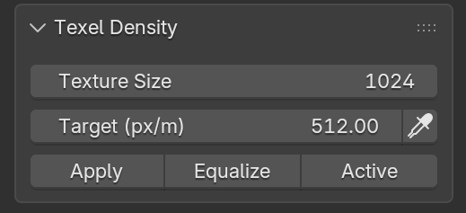

テクセル密度は、3D 表面 1 m にテクスチャのピクセルが何個入るか（px/m）を表します。アイランドごとの密度が同じだと、テクスチャの解像度が均一に見えます。

1. **Texture Size** にテクスチャ一辺のピクセル数を入れます。
2. 基準にするアイランドを選択し、スポイトボタンを押します。測定した平均が **Target (px/m)** に入り、その下に測定結果が表示されます。
3. 密度をそろえたいアイランドを選択し、Apply、Equalize、Active のどれかを押します。

| ボタン | 動作 |
|---|---|
| Apply | 選択したアイランドを Target の値に合わせます。 |
| Equalize | 選択したアイランドを平均密度に統一します。全体の大きさはほぼ保たれます。 |
| Active | アクティブな面（最後にクリックした面）が属するアイランドの密度に合わせます。 |

Apply を押した直後は、Blender の左下（または Edit → Adjust Last Operation）の調整パネルで、Texture Size と Target (px/m) を結果を見ながら調整できます。サイドバーの設定値は変わらず、押すたびにパネルの値から再開します。Equalize と Active は UV で測った密度を使うので、調整する値はありません。

測定結果は 2 つの形式で表示されます。

- `Measured: 512.0 px/m (4 islands, uniform)`: 密度がすべて同じです。
- `Measured: 210.5 - 890.2 px/m (4 islands)`: 最も低い値と最も高い値です。差が大きいときは Equalize や Apply が必要です。

注意点:

- Texture Size は単位の換算にだけ使われ、値を変えても UV は動きません。
- 密度はオブジェクトのスケールを反映して計算するので、複数のオブジェクトの密度をそろえるときも実際の大きさが基準です。
- アイランドはその場で大きさが変わるだけなので、互いに重なることがあります。適用したあとは配置を確認してください。
- スポイトは測定だけで、UV は変えません。

### UV Vertices

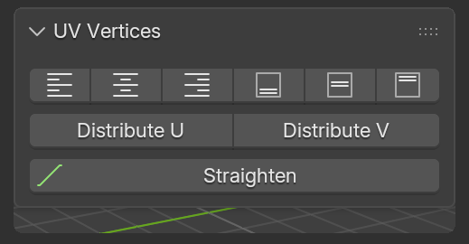

アイランドではなく、選択した UV 頂点だけを動かします。曲がったエッジを一直線にそろえるときに使います。

6 つのボタンの動作は、左から順に次のとおりです。

| ボタン | 動作 |
|---|---|
|  | 選択した頂点を一番左の頂点に揃え、縦の一直線にします。 |
|  | 選択した頂点を平均の水平位置に揃え、縦の一直線にします。 |
|  | 選択した頂点を一番右の頂点に揃え、縦の一直線にします。 |
|  | 選択した頂点を一番下の頂点に揃え、横の一直線にします。 |
|  | 選択した頂点を平均の垂直位置に揃え、横の一直線にします。 |
|  | 選択した頂点を一番上の頂点に揃え、横の一直線にします。 |
| Distribute U / V | 両端の頂点はそのままにして、残りを等間隔に置きます。 |
| Straighten | つながった UV エッジの一本の線を、両端の頂点を結ぶ直線上に置きます。頂点間の間隔の比率は元のままです。 |

- 頂点を整列するには 2 つ以上、分配するには 3 つ以上を選択する必要があります。
- 分配は U または V の一方向にだけ動き、頂点の順序は現在の並び順に従います。
- **Straighten** は、選択した頂点が両端が 2 つの一本の線としてつながっている必要があります。輪になっていたり枝分かれがあったりすると、スキップして警告を出します。両端の頂点は動かず、斜めの線は斜めのままのばされます。線が複数あっても、それぞれ別々にのばされます。
- エッジ一本をまっすぐにするには、その線の頂点を選択します。元の間隔の比率を保ちたいなら Straighten を使ってください。縦に立った線なら  ボタンで一直線にしてから Distribute V で、横に寝た線なら  ボタンで一直線にしてから Distribute U で間隔を均等にします。

### Stitch

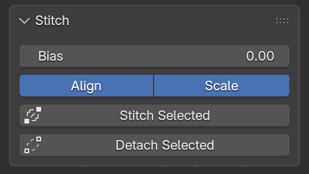

選択した UV エッジを、継ぎ目の向こう側のアイランドにある同じエッジにくっつけます。

1. くっつけたい UV エッジを選択します。複数を一緒に選んでもかまいません。
2. Bias とオプションを決めます。
3. **Stitch Selected** を押します。

Stitch Selected を押した直後は、Blender の左下（または Edit → Adjust Last Operation）の調整パネルで、Bias、Align Clusters、Scale Clusters を結果を見ながら調整できます。サイドバーの設定値は変わらず、押すたびにパネルの値から再開します。

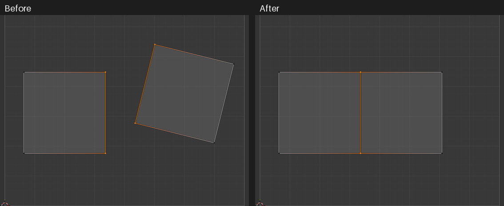

| オプション | 動作 |
|---|---|
| Bias 0 | 選択した側のアイランドはそのままで、隣のアイランドが動いてくっつきます。 |
| Bias 1 | 隣のアイランドはそのままで、選択した側が動いてくっつきます。 |
| Bias 0.5 | 2 つのアイランドが互いに半分ずつ動き、中間で出会います。 |
| Align (Align Clusters) | 動くアイランドを回して、エッジの向きを合わせます。 |
| Scale (Scale Clusters) | 動くアイランドの大きさを変えて、エッジの長さを合わせます。 |

通常は Align と Scale を両方オンにして使います。両方をオフにしたり、アイランドの形が違っていたり（きれいな四角形でない、つぶれた面など）しても、継ぎ目の両端の点は最後に正確にくっつきます。

- Align と Scale をオンにした場合: アイランドを回して大きさを合わせたあと、残った小さな差だけを端点でくっつけます。アイランドの形の変化が最も少なくなります。
- オフにした場合: アイランドは移動だけをし、継ぎ目の端点がくっつくときにその付近の形が伸びたり曲がったりします。

**どちらが「選択した側」か**

- エッジの片側だけが選択されている場合は、その側のアイランドが選択した側です。
- 両側が選択されている場合（3D ビューポートでエッジを選択した場合など）は、アクティブな面があるアイランドが選択した側として扱われます。そのままにしておきたいアイランドの面を最後にクリックしておいてください。

**注意点**

- 同じ 2 つのアイランドの間のエッジを複数選択すると、すべてのエッジに最もよく合う位置を一度に計算します。
- 3 つ以上のアイランドを続けてくっつけると、先にくっついたアイランドが一つのかたまりとして一緒に動きます。
- 隣のアイランドが反転している場合は、自動で反転してからくっつけます。
- アイランドが輪のようにつながる場合、最後のエッジはアイランドを再び動かさず、端点だけをくっつけます。そのため、その付近が少し引っ張られることがあります。
- くっつけたあとも、メッシュの seam の印はそのまま残ります。

**Detach Selected（切り離し）**

Stitch の反対です。選択した UV エッジに沿って、アイランドを 2 つ以上に切ります。

1. 切る線になる UV エッジを選択します。線はアイランドの縁から縁まで（または別の切る線まで）つながっている必要があります。
2. **Detach Selected** を押します。
3. 押した直後に、調整パネルの **Gap** で切れた部分の間隔を決めます。初期値は 0.02 UV 単位です。

- 切れた部分は、アイランドの中心から外側へ Gap の半分ずつ動きます。そのため、2 つに切ったときは両側が同じだけ開きます。3 つ以上に切ったとき、中央の部分のように中心にある部分は動きません。
- 選択したエッジがアイランドを 2 つに分けられない場合（縁に届かない線など）は、何も変わらず警告だけが出ます。
- 切り離したあとも、メッシュの seam の印は変わりません。Stitch でもう一度くっつけられます。
- アイランド内の頂点をすべて選択して押すと、すべての面がばらばらに切り離されるので注意してください。

### Unstretch

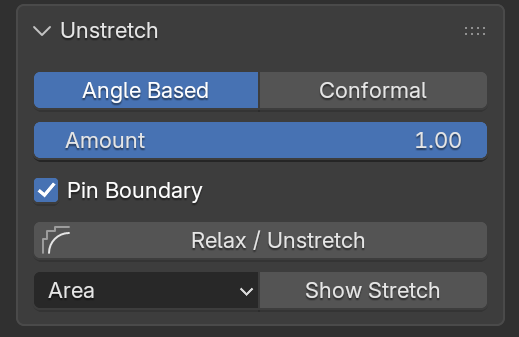

テクスチャが引き伸ばされて見える UV を直します。選択した UV 頂点の位置を 3D 表面の形を基準に計算し直して、3D での実際の比率に近づけます。

1. ほぐしたい領域の UV 頂点を選択します。
2. Method と Amount を決めます。
3. **Relax / Unstretch** を押します。

Relax / Unstretch を押した直後は、Blender の左下（または Edit → Adjust Last Operation）の調整パネルで、Method、Pin Boundary、Amount を結果を見ながら調整できます。サイドバーの設定値は変わらず、押すたびにパネルの値から再開します。

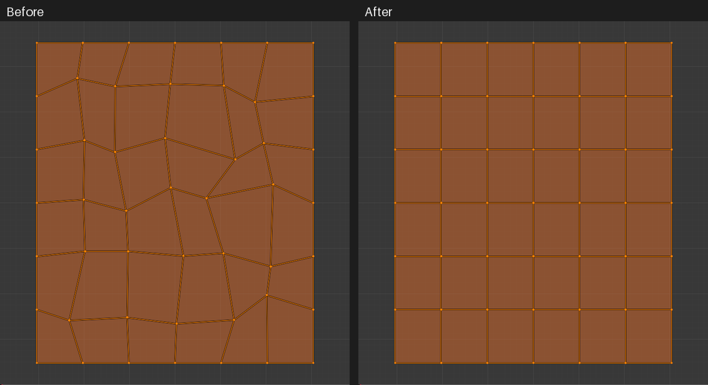

| 設定 | 動作 |
|---|---|
| Angle Based | 角度をできるだけ保ちます。ほとんどの場合、この方式で問題ありません。 |
| Conformal | 形は保ちますが、大きさが変わることがあります。 |
| Amount | ほぐした結果にどれだけ近づけるかを決めます。1 なら最後まで、0.5 なら半分だけ動かします。 |
| Pin Boundary（初期値オン） | アイランドの輪郭はそのままにして、内側の頂点だけを均一にほぐします。輪郭が変わらないので、アイランドの形と位置は変わらず、隣のアイランドと重なることもありません。オフにすると、輪郭を含めて選択した頂点全体をほぐします。 |

**Pin Boundary を使うときの注意点**

- オンのときは、輪郭上の頂点は選択しても動きません。面が 1 つだけのアイランドのようにすべての頂点が輪郭上にあると、何も変わらず警告だけが出ます。
- 輪郭がすでに 3D 表面の比率とずれてゆがんでいる場合は、Pin Boundary をオフにして実行してください。オンにしておくと輪郭が固定されて内側もその輪郭に合わされるので、かえってゆがみが大きくなることもあります。
- オフにすると、アイランドの位置、大きさ、向きはほぼそのままで、形だけがほぐれます。ただし形が大きく変わって隣のアイランドと重なることがあり、特に Conformal は変化が大きいので勧めません。

**その他**

- 動かしたくない頂点には、ピン（P キー）を打っておいてください。
- ブラシのようにこする方式ではなく、ボタンを押すたびに一度だけ計算します。少しずつほぐしたいときは Amount を下げて何度か押してください。

**Show Stretch** は、UV エディターの引き伸ばし表示のオンとオフを切り替えます。隣のリストで、Area（面積の歪み）と Angle（角度の歪み）のどちらを見るかを選びます。青に近いほど歪みが少ないことを表します。UV エディターが 1 つ以上開いている必要があります。

### Connected Edges

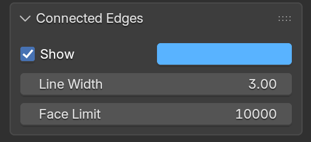

選択した点、エッジ、面が別のアイランドのどこにつながるかを、UV エディターに色で表示します。seam で分かれた反対側を探すときに使います。

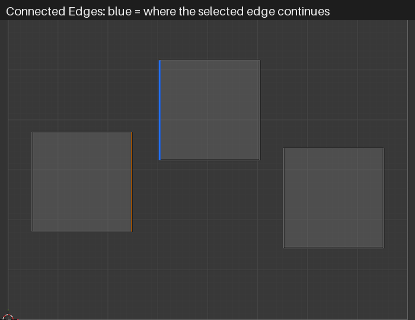

| 設定 | 動作 |
|---|---|
| Show | 表示のオンとオフを切り替えます。初期値はオンです。隣の色欄で表示色を変えられます。 |
| Line Width | 線の太さです。点はこれより少し大きく描かれます。 |
| Face Limit | Edit Mode の面の数がこの値を超えると、表示をスキップします。初期値は 10,000 です。 |

- 頂点選択モードでは点で、エッジ・面選択モードでは線で表示します。
- 反対側がすでに同じ位置にくっついている場合や、反対側も一緒に選択されている場合は表示しません。
- 移動、回転、拡大縮小をしている間は表示が一時的に消え、マウスを離すと再び現れます。
- 面の多いメッシュで UV エディターが重くなったら、Face Limit を下げるか、表示をオフにしてください。
- 面の数が Face Limit を超えて表示をスキップした場合は、UV エディターの左上に、どの表示が抜けているかを示す案内文が出ます。

### About

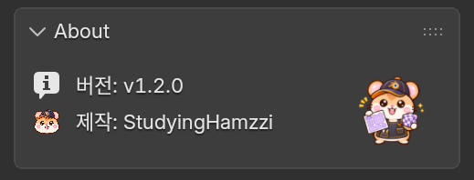

バージョンと制作者を確認できます。（パネル内の表記は韓国語です。「버전」= バージョン、「제작」= 制作。）

| 項目 | 内容 |
|---|---|
| 制作 | Studying Hamzzi |
| 協力 | Claude (Anthropic) |
| 画像 | AI 生成 |
| ライセンス | GPL-3.0-or-later（ソースコード）。全文はリポジトリの [LICENSE](../LICENSE) にあります。 |

### メニューとショートカット

**UV メニュー**: UV エディターの UV メニューの一番下に **Hamzzi UV Toolkit** の項目があります。サイドバーのほとんどのボタン（整列、分配、タイル、回転、密度、Straighten、Stitch、Detach、Relax）をメニューからも使えます。値が必要なツールは、サイドバーに入れてある値で実行されます。

**UV メニューの開き方**

1. メッシュオブジェクトを Edit Mode にして、UV エディターを開きます（UV Editing ワークスペースが便利です）。
2. UV エディター上部の **UV** メニューを開きます。
3. メニュー一番下の **Hamzzi UV Toolkit** にマウスを乗せると、Islands、Transform、Texel Density、UV Vertices、Seams、Relax / Unstretch の順にツールの一覧が開きます。

**ショートカット**: 初期設定で割り当てられているキーはありません。Stitch Selected と Detach Selected だけが、キーの欄を空にした状態で登録されています。既存のキーと重ならないように最初は空にしてあるので、好きなキーを自分で割り当ててください。

*Preferences で割り当てる（推奨）*

1. Edit → Preferences → Keymap を開きます。
2. 検索方式を Name にして、`Stitch` または `Detach` を検索します。
3. UV Editor と Mesh の下に、Stitch Selected と Detach Selected が `None` として表示されます。
4. キーの欄をクリックして、使いたいキーの組み合わせを押します。UV エディターと 3D ビューポート（Edit Mode）の両方で使うには、UV Editor と Mesh の両方に同じキーを割り当てます。
5. Preferences は自動で保存されます。自動保存がオフの場合は Save Preferences を押します。

*UV メニューから直接割り当てる*

1. UV メニュー → Hamzzi UV Toolkit で、**Stitch Selected** にマウスを乗せて右クリックします。
2. **Assign Shortcut** を選び、使いたいキーを押します。
3. この方法では UV Editor にだけ割り当てられます。3D ビューポートでも使うには、上の Preferences で Mesh 側も割り当ててください。

- すでに使われているキーと重なると、Preferences に競合の表示が出ます。重ならない組み合わせを選んでください。
- 割り当てたキーを消すには、キー欄の横の X ボタンを押します。
- メニューの項目の右側には、割り当てたショートカットが一緒に表示されます。

## 作業例

### アトラスを整理する

1. UV エディターで A キーを押し、整理するアイランドをすべて選択します。
2. Transform で **Auto H** を押し、アイランドをまっすぐに立てます。
3. Texel Density で Texture Size を入れて **Equalize** を押し、密度を統一します。
4. Tile / Pack で U 0、V 0 を確認し、Margin を小さく設定して **Pack into Tile** を押し、タイルの中に行ごとに配置します。
5. 一部だけを別に手直しするなら、アイランドを選択して Align Islands と **Distribute U / V** で整えます。

### 分かれた seam をくっつける

1. UV エディターで、くっつけたい縁のエッジを選択します。
2. 青い表示を見て、相手のエッジがどのアイランドにあるかを確認します。
3. Stitch で Bias 0、Align と Scale をオンにした状態で **Stitch Selected** を押します。
4. 継ぎ目がかみ合ったか確認します。くっついたアイランドは一つになり、継ぎ目の端点は同じ位置に置かれます。

### アイランドを切り離して別々に使う

1. 切る線になる UV エッジを、アイランドの縁から縁まで選択します。
2. Stitch パネルで **Detach Selected** を押します。
3. 左下の調整パネル（Adjust Last Operation）で、**Gap** を調整して切れた部分の間隔を決めます。
4. もう一度くっつけたいときは、切ったエッジを選択して **Stitch Selected** を押します。

### 曲がったエッジをまっすぐにする

1. まっすぐにしたいエッジの UV 頂点を選択します。
2. UV Vertices で  ボタンを押し、頂点を横の一直線にします。
3. **Distribute U** を押して、頂点の間隔を均等にします。
4. 輪郭が整ったら、アイランド全体を選択し、Unstretch で **Relax / Unstretch** を押して、内側を均一にほぐします。

縦のエッジは  ボタンと **Distribute V** を使います。

### 3D モデルの順に並べる

1. 並べるアイランドを選択します（選択がなければ全体）。
2. Distribute / Sort で基準の軸（X、Y、Z）を選びます。
3. **Sort U**（横）または **Sort V**（縦）を押します。
4. タイルに収めるには、続けて Tile / Pack の **Pack into Tile** を押します。

### 複数のオブジェクトのテクセル密度をそろえる

1. 密度をそろえるオブジェクトをすべて選択して、一緒に Edit Mode に入ります。
2. 基準にする面を 1 つクリックします。この面がアクティブな面になります。
3. A キーで全体を選択します。
4. Texel Density で **Active** を押すと、すべてのアイランドが基準の面が属するアイランドの密度に合わせられます。

### UDIM タイルに分ける

1. 移動するアイランドを選択します。
2. Tile / Pack で、U, V にタイル番号を入れます。
3. **Move to Tile** を押します。

## 警告メッセージとトラブルシューティング

ツールを実行したときに、画面下のステータスバー（と Info エディター）に表示されるメッセージです。

| メッセージ | 意味と対処 |
|---|---|
| No UV islands found | 処理するアイランドがありません。UV エディターのヘッダーにある UV Sync Selection ボタン（矢印が 2 つのアイコン）がオフだと、3D ビューポートで選択した面だけが UV エディターに表示されます。その場合は、3D ビューポートで面を選択してください。アイランドを扱うすべてのツールが同じ警告を出します。 |
| No UV map on (オブジェクト名) - unwrap the mesh first (UV > Unwrap) | そのオブジェクトに UV マップがありません（一度も UV を展開していないメッシュ）。Blender で UV → Unwrap や Smart UV Project を使って、先に UV を展開してください。この警告が出たときは何も変わりません。 |
| Skipped objects without a UV map: (オブジェクト名) | 複数のオブジェクトを一緒に編集したとき、UV マップのないオブジェクトをスキップして、残りだけを処理したという通知です。 |
| Select at least two islands | Distribute と Sort は、アイランドが 2 つ以上必要です。 |
| The islands do not fit in one tile - enable Scale to Fit or lower the margin | Scale to Fit がオフで、アイランドがタイルに収まりません。Scale to Fit をオンにするか、Margin を小さくしてください。 |
| The margin is too large for this many islands - lower the margin | Scale to Fit がオンでも、Margin だけでタイルが埋まります。Margin を小さくしてください。 |
| Select a UV edge inside the island | To Edge は、基準にする UV エッジをアイランドの中で選択する必要があります。 |
| No measurable islands | 面積が 0 のアイランドしかありません。UV が一点に集まっていないか確認してください。 |
| Target (px/m) must be above zero | Target に 0 より大きい値を入れてください。 |
| No active face - select a face first | Active を使うには、面を 1 つクリックしてアクティブな面にしてください。 |
| Select at least two UV vertices | 頂点を整列するには 2 つ以上を選択する必要があります。 |
| Select at least three UV vertices | 頂点を分配するには 3 つ以上を選択する必要があります。 |
| Select UV edges that have a matching edge on another island | 選択したエッジの相手が別のアイランドにありません。seam ではないか、すでにくっついているエッジです。 |
| Select a chain of connected UV edges to straighten | Straighten には、つながった UV エッジの一本の線が必要です。頂点が両端が 2 つの一本の線になるようにエッジを選択してください。 |
| Skipped N selection(s) that are loops or branch; select a single open chain | 輪になっている、または枝分かれがある選択をスキップしたという通知です。切れた一本の線だけを選択してください。 |
| Select UV edges that cut an island in two (the cut has to reach the border of the island) | Detach Selected には、アイランドを 2 つに分ける線が必要です。選択したエッジがアイランドの縁まで届くように選択してください。 |
| Select the UV vertices you want to relax | ほぐしたい UV 頂点を選択してください。 |
| Only outline vertices are selected - select inner vertices or turn off Pin Boundary | 選択した頂点がすべてアイランドの輪郭上にあります。内側の頂点を選択するか、Pin Boundary をオフにしてください。 |
| Relax could not solve N island(s): they have no open UV border; they were left unchanged | UV に開いた境界がないアイランドです（すべてのエッジがくっついています）。ほぐせないのでそのままにしました。seam を作って UV を 1 か所以上切り、開いた境界を作ってからもう一度試してください。 |
| Relax could not solve N island(s); they were left unchanged | ほぐしに失敗したアイランドはそのままにしました。選択範囲を狭めるか、アイランドを分けてもう一度試してください。 |
| Relax failed | Blender の展開計算が失敗しました。選択範囲を狭めてもう一度試してください。 |
| Could not restore selection / seams / pins on (オブジェクト名) - press Ctrl+Z | Relax が終わったあと、そのオブジェクトの選択、seam、ピンを元に戻せませんでした。Ctrl+Z で元に戻してから、もう一度試してください。 |
| No UV editor is open | Show Stretch は UV エディターが開いている必要があります。 |

| 症状 | 確認すること |
|---|---|
| Hamzzi UV Toolkit タブがない | メッシュが Edit Mode か、アドオンが Preferences で有効になっているかを確認してください。 |
| パネルのハムスターの絵が表示されない | インストール用 zip の `images` フォルダーに `logo.png` と `mascot.png` が入っているか確認してください。絵がなくても機能は動作します。 |
| ボタンが灰色になっている | Edit Mode のメッシュオブジェクトがあるか確認してください。Scale ボタンは、U, V の倍率が両方 1 のときは無効になります。 |
| 選択したよりも多く動く | アイランド系のツールは、頂点を 1 つだけ選択しても、その頂点が属するアイランド全体を動かします。選択がなければ、見えているアイランド全体に適用されます。 |
| 密度をそろえたらアイランドが重なる | 正常な動作です。密度をそろえると、アイランドがその場で大きくなったり小さくなったりするためです。Pack into Tile や Blender の Pack Islands で配置し直してください。 |
| Relax したあとアイランドが隣と重なる | Pin Boundary をオフにしてほぐしたときに起こることがあります。Pin Boundary をオンにすると輪郭が変わらないので重なりません。 |
| 反転した面が塗られない | Transform パネルの Show Flipped がオンか、UV エディターが開いているか、面の数が Face Limit を超えていないかを確認してください。非表示の面は検査しません。 |
| Connected Edges が表示されない | 表示がオンか、面の数が Face Limit を超えていないかを確認してください。選択したエッジの反対側がすでにくっついている場合は表示されません。 |
| UV エディターでドラッグすると重い、または Blender が固まる | Connected Edges の Show をオフにして、もう一度試してください。続くようなら、[バグとお問い合わせ](#バグとお問い合わせ)を参考に、リポジトリの Issues でお知らせください。 |
| パネルが古いバージョンの表示のまま | 新しい zip をインストールしたあと、Blender を再起動してください。 |

## バグとお問い合わせ

アドオンを使っていてバグに出会ったときや、質問や希望する機能があるときは、リポジトリの [Issues](https://github.com/STmagi20/HamzziUVWs/issues) に書いてください。

まず、同じ内容がすでに投稿されていないか探してみてください。新しく投稿するときは、次の内容を一緒に書くと原因を見つけやすくなります。

- **Blender のバージョンとアドオンのバージョン**: アドオンのバージョンは About パネルで確認できます。
- **何をしたか**: どのパネルのどのボタンを押したか、そのとき何を選択していたか（点、エッジ、面、アイランド）、UV Sync がオンだったかを書いてください。
- **何が起きたか**: 期待した結果と実際の結果、画面下のステータスバーに出た警告の文言をそのまま書いてください。
- **スクリーンショット**: 実行前後の UV エディターの画面があると大変助かります。
- 何度も繰り返す問題なら、どんな順序で行うとまた現れるかを書いてください。

## 既知の制限

- Stitch は選択したエッジにだけ動作し、近くのエッジを自動で探してくっつけることはしません。
- Unstretch はブラシではなく、選択領域に一度に適用されます。
- 球のように平らに展開できない形を強制的に展開する機能は、まだありません。
- Pack into Tile はアイランドのバウンディングボックスを基準に配置し、回転しません。
- 密度を変えても、アイランドを自動で配置し直すことはしません。
- Connected Edges は、面が Face Limit を超えると表示をスキップします。
- パネルのボタン名は英語です。
