# Hamzzi UV Toolkit 사용 가이드

Hamzzi UV Toolkit은 이미 펼친 UV를 다듬는 Blender 애드온입니다. 사이드바 버튼으로 아일랜드 정렬과 배치, 이음선 붙이기, 늘어진 UV 풀기, 텍셀 밀도 맞추기를 할 수 있습니다. UV를 새로 펼치는 기능은 없습니다.

## 목차

1. [설치](#설치)
2. [시작하기](#시작하기)
3. [기능 한눈에 보기](#기능-한눈에-보기)
4. [패널별 사용법](#패널별-사용법)
   - [Align Islands](#align-islands)
   - [Distribute / Sort](#distribute--sort)
   - [Tile / Pack](#tile--pack)
   - [Transform](#transform)
   - [Texel Density](#texel-density)
   - [UV Vertices](#uv-vertices)
   - [Stitch](#stitch)
   - [Unstretch](#unstretch)
   - [Connected Edges](#connected-edges)
   - [About](#about)
5. [작업 예시](#작업-예시)
6. [경고 메시지와 문제 해결](#경고-메시지와-문제-해결)
7. [알려진 한계](#알려진-한계)

## 설치

Blender 4.2 이상이 필요합니다. 테스트는 5.2에서 했고, 그 아래 버전에서는 실행해 보지 않았습니다.

1. 저장소의 Releases에서 `HamzziUVToolkit.zip`을 받습니다. 압축은 풀지 않습니다.
2. Blender에서 Edit → Preferences → Get Extensions를 엽니다.
3. 오른쪽 위 화살표 메뉴에서 **Install from Disk**를 고르고 zip을 선택합니다.
4. Add-ons 목록에서 Hamzzi UV Toolkit이 켜져 있는지 확인합니다.

업데이트할 때는 새 zip 파일을 설치해 주세요. 패널이 이전 모습이라면 Blender를 다시 시작합니다.

## 시작하기

1. 메시 오브젝트를 선택하고 Tab 키로 Edit Mode에 들어갑니다.
2. 3D 뷰포트나 UV 에디터에서 N 키로 사이드바를 엽니다.
3. **Hamzzi UV Toolkit** 탭을 누릅니다.

> 이 애드온은 이미 펼친 UV를 다듬는 도구입니다. UV 맵이 없는 메시에서는 경고가 나오고 아무것도 바뀌지 않으니, Blender에서 UV를 먼저 펼치세요(UV → Unwrap, Smart UV Project 등).

- 패널 제목을 누르면 접거나 펼 수 있습니다. Connected Edges와 About은 처음에 접혀 있습니다.
- 패널은 Edit Mode에서만 보입니다. 3D 뷰포트와 UV 에디터 양쪽에 같은 패널이 있습니다. 결과를 바로 보려면 UV 에디터를 함께 열어 두는 것이 좋습니다.
- 아이콘만 있는 버튼은 마우스를 올리면 설명이 나옵니다.

 

## 기능 한눈에 보기

자세한 사용법은 [패널별 사용법](#패널별-사용법)에 있습니다.

| 작업 | 사용할 패널 |
|---|---|
| 아일랜드를 가장자리나 가운데에 맞춤 | Align Islands |
| 아일랜드 사이 간격을 고르게 분배 | Distribute / Sort (Distribute U / V) |
| 3D 위치 순서대로 아일랜드를 한 줄로 나열 | Distribute / Sort (Sort U / V) |
| 흩어진 아일랜드를 타일 안에 정리 | Tile / Pack (Pack into Tile) |
| 아일랜드를 다른 UDIM 타일로 이동 | Tile / Pack (Move to Tile) |
| 회전, 뒤집기, 비스듬한 아일랜드 바로 세우기 | Transform |
| 아일랜드마다 다른 해상도(텍셀 밀도) 통일 | Texel Density |
| 비뚤어진 UV 엣지를 일직선으로 정렬 | UV Vertices |
| 갈라진 이음선 붙이기 | Stitch |
| 늘어지거나 찌그러진 UV 풀기 | Unstretch |
| UV가 거꾸로 놓인(뒤집힌) 면 찾기 | Transform (Show Flipped) |
| 선택한 엣지의 짝이 있는 위치 확인 | Connected Edges |

## 패널별 사용법

### Align Islands

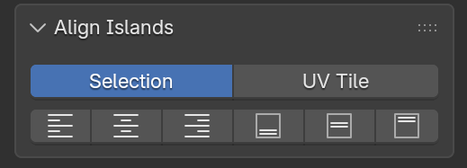

아일랜드를 가장자리나 가운데에 맞춥니다. 모양은 바뀌지 않고 위치만 움직입니다.

1. 맨 위의 두 버튼(Selection, UV Tile)에서 기준을 고릅니다.
2. 아이콘 버튼을 누릅니다.

| 기준 | 동작 |
|---|---|
| Selection | 아일랜드 전체를 감싸는 사각형의 가장자리에 맞춥니다. |
| UV Tile | 그 사각형의 중심이 있는 0–1 타일의 가장자리에 맞춥니다. |

버튼 6개의 동작은 왼쪽부터 순서대로 아래와 같습니다. 가장자리와 가운데는 위에서 고른 기준(Selection 또는 UV Tile)을 따릅니다.

| 버튼 | 동작 |
|---|---|
|  | 왼쪽 가장자리에 맞춥니다. |
|  | 가로 방향 가운데에 맞춥니다. |
|  | 오른쪽 가장자리에 맞춥니다. |
|  | 아래쪽 가장자리에 맞춥니다. |
|  | 세로 방향 가운데에 맞춥니다. |
|  | 위쪽 가장자리에 맞춥니다. |

아일랜드 하나를 타일 한가운데에 놓으려면 기준을 UV Tile로 고르고   버튼을 차례로 누릅니다.

### Distribute / Sort

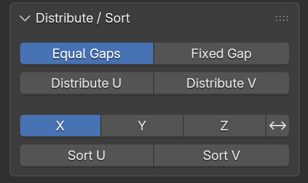

**Distribute U / V**는 아일랜드 사이의 간격을 고르게 하면서 가로(U) 또는 세로(V)로 늘어놓습니다. 아일랜드가 두 개 이상 필요합니다. 지금 놓인 순서(왼쪽에서 오른쪽, 또는 아래에서 위)대로 나열하고, 맨 앞 아일랜드는 제자리에 둡니다.

| 설정 | 동작 |
|---|---|
| Equal Gaps | 양 끝은 그대로 두고 그 사이의 간격을 똑같이 나눕니다. 전체 폭은 변하지 않습니다. |
| Fixed Gap | 맨 앞 아일랜드부터 Gap 값만큼 띄워 차례로 놓습니다. Fixed Gap을 고르면 Gap 칸이 나타나며 기본값은 0.01입니다. 음수를 적으면 겹치게 놓습니다. |

**Sort U / Sort V**는 아일랜드를 **3D 공간에서의 위치 순서**대로 한 줄(U) 또는 한 열(V)에 나란히 놓습니다. 3D 모델에서 가까이 있는 부분이 UV에서도 가까이 놓이게 하고 싶을 때 씁니다. 아일랜드가 두 개 이상 필요합니다.

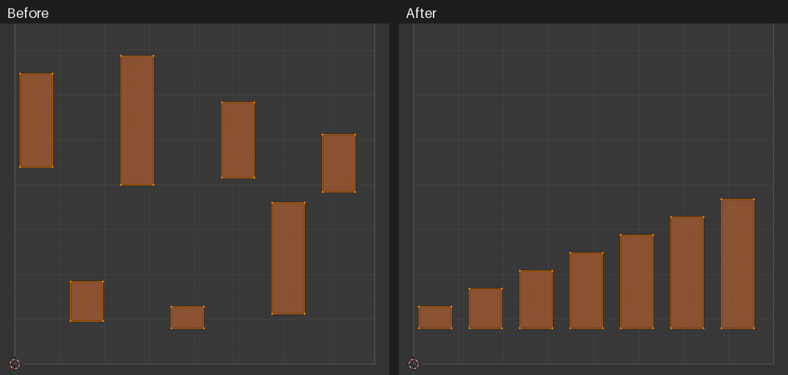

| 설정 | 동작 |
|---|---|
| X / Y / Z | 순서를 정할 3D 축을 고릅니다. 값이 작은 아일랜드가 먼저(왼쪽 또는 아래쪽)에 놓입니다. |
| X / Y / Z 오른쪽의 ↔ 버튼 | 켜면 순서를 거꾸로 합니다. |
| Sort U | 가로 한 줄로 놓고 아래쪽 가장자리를 맞춥니다. |
| Sort V | 세로 한 줄로 놓고 왼쪽 가장자리를 맞춥니다. |

- 순서는 아일랜드에 속한 면들의 중심 위치(월드 좌표 기준)로 정합니다. 오브젝트를 옮기거나 돌려 두었어도 화면에 보이는 위치가 기준입니다. 여러 오브젝트를 함께 편집하면 오브젝트와 상관없이 한 줄로 섞어서 나열합니다.
- 간격은 Distribute와 같은 설정(Equal Gaps, Fixed Gap)을 따릅니다. Equal Gaps는 처음에 아일랜드들이 차지하던 폭 안에서 간격을 고르게 나누되, 서로 겹치지 않게 합니다.
- 아일랜드의 크기를 바꾸거나 회전하지 않습니다. 한 줄에 모두 놓다 보면 타일 밖으로 나갈 수 있으니, 타일 안에 담으려면 이어서 Pack into Tile을 사용하세요.
- Distribute와 Sort를 누른 직후에는 조정 패널(Adjust Last Operation)에서 간격 방식과 Gap, Sort의 Order By와 Reverse를 바꿔 다시 적용해 볼 수 있습니다. 패널의 설정값은 바뀌지 않습니다.

### Tile / Pack

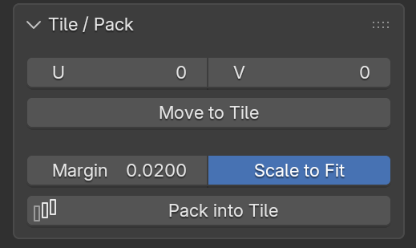

맨 위의 **U, V**는 Move to Tile과 Pack into Tile이 함께 쓰는 타일 번호입니다. 기본값은 U 0, V 0이고, UV 에디터에 보이는 기본 사각형(0–1 타일)을 가리킵니다.

| U, V | 위치 |
|---|---|
| 0, 0 | 기본 0–1 사각형 |
| 1, 0 | 기본 사각형 오른쪽 옆 |
| 0, 1 | 기본 사각형 위 |

정리한 아일랜드가 사각형 바깥에 놓였다면 U, V가 0, 0인지 먼저 확인하세요.

**Move to Tile**은 아일랜드를 U, V에 적은 UDIM 타일로 옮깁니다. 타일 안에서의 위치는 그대로 유지됩니다.

- U 0, V 0은 기본 0–1 타일(1001)입니다. U 1, V 0은 1002, U 0, V 1은 1011입니다.
- 아일랜드가 지금 어느 타일에 있는지는 중심 위치로 판단합니다.
- 누른 직후에는 조정 패널(Adjust Last Operation)에서 U, V를 바꿔 다른 타일로 옮겨 볼 수 있습니다. Tile / Pack 패널의 U, V는 바뀌지 않습니다.

**Pack into Tile**은 흩어진 아일랜드를 U, V에 적은 타일 안에 줄 맞춰 자동으로 배치합니다. 타일의 왼쪽 아래에서 시작해 오른쪽으로 채우고, 한 줄이 차면 다음 줄로 올라갑니다.

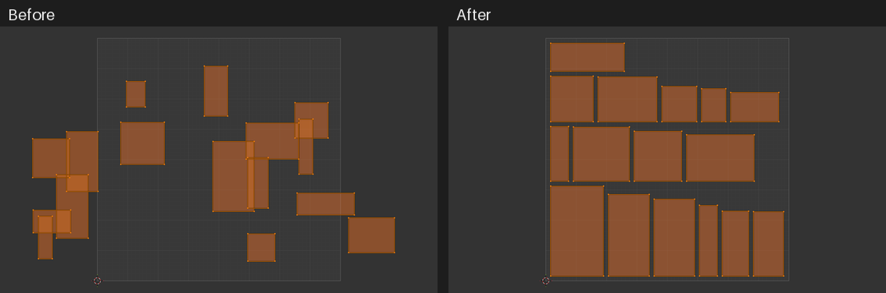

| 설정 | 동작 |
|---|---|
| Margin | 아일랜드 사이와 타일 테두리에 남길 간격입니다. 단위는 UV(타일 한 칸 = 1)이고, 0이면 서로 맞붙습니다. 최댓값은 0.25입니다. |
| Scale to Fit (켬) | 타일을 가장 크게 채우도록 모든 아일랜드를 같은 배율로 키우거나 줄입니다. |
| Scale to Fit (끔) | 크기는 그대로 두고 위치만 옮깁니다. 타일에 다 들어가지 않으면 경고를 내고 아무것도 바꾸지 않습니다. |

- **Margin과 Scale to Fit의 관계**: Margin은 Pack into Tile에서만 쓰는 설정입니다. Scale to Fit은 그 간격을 지키면서 아일랜드를 어떻게 넣을지 정합니다.
  - 켜 두면 아일랜드 크기를 바꿔서라도 Margin을 항상 지킵니다. 쓸 수 있는 영역이 `1 − 2×Margin`이라서 Margin이 클수록 아일랜드가 작아집니다(0.25면 타일 가운데 절반 영역만 사용합니다).
  - 꺼 두면 크기를 건드리지 않으므로, Margin 때문에 자리가 모자랄 때는 경고만 내고 아무것도 바꾸지 않습니다.
  - 켜 둔 상태에서도 Margin이 너무 커서 간격만으로 타일이 가득 차면(예: Margin 0.25에 아일랜드 10개) 경고가 나옵니다. 이때는 Margin을 줄이세요. 보통 0.005~0.02면 충분합니다.
- Pack into Tile을 누른 직후에는 Blender 왼쪽 아래(또는 Edit → Adjust Last Operation)의 조정 패널에서 Margin, Scale to Fit, U, V를 바꿔 결과를 보면서 다듬을 수 있습니다. 패널의 설정값은 바뀌지 않고, 누를 때마다 패널 값으로 다시 시작합니다.
- 모든 아일랜드에 같은 배율을 적용하므로 아일랜드끼리의 텍셀 밀도 비율은 변하지 않습니다.
- 아일랜드를 회전하지 않습니다. 비스듬한 아일랜드는 먼저 Auto H / Auto V로 세워 두면 빈틈이 줄어듭니다.
- 키가 큰 아일랜드부터 놓고, 높이가 같으면 지금 놓인 위치의 왼쪽부터 놓습니다.
- 아일랜드를 감싸는 사각형(경계 상자)을 기준으로 배치합니다. 복잡한 모양을 빈틈없이 끼워 넣으려면 Blender의 Pack Islands가 더 촘촘하게 배치합니다.

### Transform

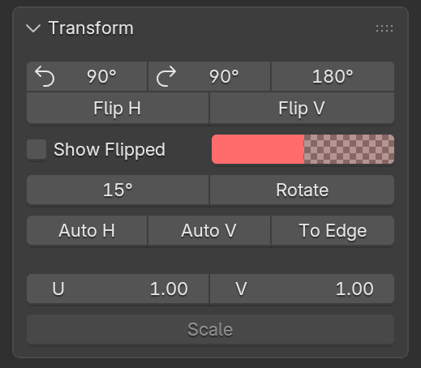

회전, 뒤집기, 배율은 아일랜드마다 자기 중심(아일랜드를 감싸는 사각형의 가운데)을 기준으로 합니다.

| 버튼 | 동작 |
|---|---|
| ↺ 90° / ↻ 90° / 180° | 반시계 방향 90°, 시계 방향 90°, 180° 회전합니다. |
| Flip H / Flip V | 좌우, 상하로 뒤집습니다. |
| Show Flipped + 색 칸 | 뒤집힌 면을 UV 에디터에서 색으로 칠합니다. 기본은 꺼짐입니다. |
| 각도 칸 + Rotate | 칸에 적은 각도만큼 회전합니다. 양수는 반시계 방향입니다. |
| Auto H / Auto V | 아일랜드를 감싸는 사각형이 가장 작아지는 각도로 돌린 뒤, 긴 쪽을 가로(H) 또는 세로(V)에 맞춥니다. |
| To Edge | 선택한 UV 엣지가 가장 가까운 가로·세로 축에 놓이도록 아일랜드를 돌립니다. |

- Auto H / V는 아일랜드를 감싸는 가장 작은 사각형이 되는 각도를 정확하게 계산합니다. 비스듬히 놓인 아일랜드를 반듯하게 세울 때 씁니다.
- To Edge는 아일랜드 안에서 기준이 될 엣지를 먼저 선택해야 합니다. 엣지를 여러 개 골랐다면 아일랜드마다 가장 긴 엣지 하나를 기준으로 삼습니다.
- 뒤집으면 텍스처가 거울에 비친 것처럼 보입니다. 글자나 로고가 있는 면에서는 주의하세요.
- 각도 칸 + Rotate를 누른 직후에는 조정 패널(Adjust Last Operation)에서 Angle을 바꿔 다시 돌려 볼 수 있습니다. 패널의 각도 칸은 바뀌지 않습니다.

**뒤집힌 면 표시**: Show Flipped를 켜면 UV 에디터에서 뒤집힌 면이 빨간색으로 칠해집니다. 뒤집힌 면은 모델을 바깥에서 봤을 때 텍스처가 좌우 반전되어 보이는 면입니다. 면의 노멀이 안쪽을 향해도 바깥에서 텍스처가 바르게 보이면 뒤집힌 것으로 치지 않습니다. 칠해진 면이 한 아일랜드 전체라면 Flip H / Flip V로 바로잡을 수 있습니다.

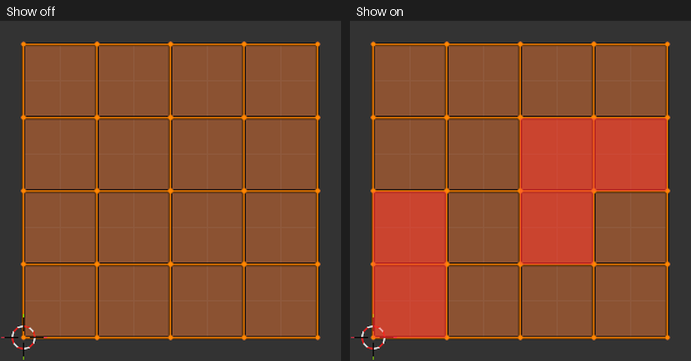

- 표시만 하며 선택하거나 고치지는 않습니다.
- 대칭 모델에서는 텍스처를 아끼려고 한쪽을 일부러 거울상으로 겹쳐 놓기도 합니다. 뒤집힌 면이 항상 잘못은 아니니, 의도한 것인지 확인하고 고치세요.
- 화면에 보이는 면만 검사합니다. 숨긴 면은 포함되지 않고, UV Sync가 꺼져 있으면 3D 뷰포트에서 선택한 면만 대상입니다.
- 엣지로 이어진 면들을 한 덩어리로 보고, 덩어리가 감싸는 부피로 바깥쪽을 정합니다. 구멍이 많이 뚫린 모델은 바깥쪽을 잘못 잡을 수 있습니다. 납작한 한 장짜리는 노멀이 향한 쪽을 바깥으로 봅니다.
- UV 면적이 거의 0인 면은 방향을 알 수 없어서 검사하지 않습니다.
- 면이 Face Limit(Connected Edges 설정과 같은 값)을 넘으면 표시를 건너뛰고, UV 에디터 왼쪽 위에 안내 문구를 띄웁니다.

**Scale**: 패널 아래쪽의 U, V 칸에 배율을 적고 **Scale**을 누르면, 아일랜드마다 자기 중심을 기준으로 크기를 바꿉니다.

- U 2, V 2는 두 배로 키우고, U 0.5, V 0.5는 절반으로 줄입니다.
- U와 V에 다른 값을 적으면 한쪽 방향으로만 늘어나서 텍스처가 찌그러져 보입니다.
- 두 값이 모두 1이면 바꿀 것이 없어서 버튼이 비활성화됩니다.
- 누를 때마다 배율이 거듭 적용됩니다.
- 누른 직후에는 조정 패널(Adjust Last Operation)에서 U, V 배율을 바꿔 다시 적용해 볼 수 있습니다. 이때는 누르기 전 크기에서 다시 계산하므로 거듭 적용되지 않습니다.

### Texel Density

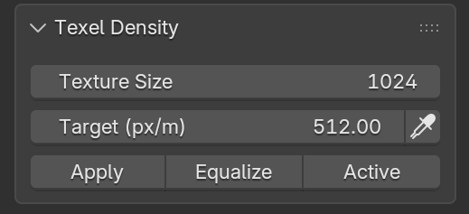

텍셀 밀도는 3D 표면 1m에 텍스처 픽셀이 몇 개 들어가는지(px/m)를 나타냅니다. 아일랜드마다 밀도가 같아야 텍스처 해상도가 고르게 보입니다.

1. **Texture Size**에 텍스처 한 변의 픽셀 수를 적습니다.
2. 기준이 될 아일랜드를 선택하고 스포이드 버튼을 누릅니다. 측정한 평균이 **Target (px/m)**에 채워지고, 아래에 측정 결과가 나타납니다.
3. 밀도를 맞출 아일랜드를 선택하고 Apply, Equalize, Active 중 하나를 누릅니다.

| 버튼 | 동작 |
|---|---|
| Apply | 선택한 아일랜드를 Target 값에 맞춥니다. |
| Equalize | 선택한 아일랜드를 평균 밀도로 통일합니다. 전체 크기는 비슷하게 유지됩니다. |
| Active | 활성 면(마지막에 클릭한 면)이 속한 아일랜드의 밀도에 맞춥니다. |

Apply를 누른 직후에는 Blender 왼쪽 아래(또는 Edit → Adjust Last Operation)의 조정 패널에서 Texture Size와 Target (px/m)을 바꿔 결과를 보면서 다듬을 수 있습니다. 패널의 설정값은 바뀌지 않고, 누를 때마다 패널 값으로 다시 시작합니다. Equalize와 Active는 UV에서 잰 밀도를 쓰므로 조정할 값이 없습니다.

측정 결과는 두 가지 형태로 표시됩니다.

- `Measured: 512.0 px/m (4 islands, uniform)`: 밀도가 모두 같습니다.
- `Measured: 210.5 - 890.2 px/m (4 islands)`: 가장 낮은 값과 가장 높은 값입니다. 차이가 크면 Equalize나 Apply가 필요합니다.

알아둘 점:

- Texture Size는 단위를 환산하는 데에만 쓰이며, 값을 바꿔도 UV는 움직이지 않습니다.
- 밀도는 오브젝트의 스케일을 반영해 계산하므로, 여러 오브젝트의 밀도를 맞출 때도 실제 크기를 기준으로 합니다.
- 아일랜드가 제자리에서 크기만 바뀌기 때문에 서로 겹칠 수 있습니다. 적용한 뒤에는 배치를 다시 확인하세요.
- 스포이드는 측정만 하고 UV는 바꾸지 않습니다.

### UV Vertices

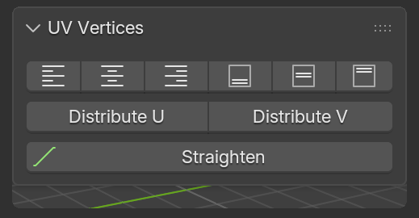

아일랜드가 아니라 선택한 UV 정점만 움직입니다. 비뚤어진 엣지를 일직선으로 펼 때 씁니다.

버튼 6개의 동작은 왼쪽부터 순서대로 아래와 같습니다.

| 버튼 | 동작 |
|---|---|
|  | 선택한 정점을 가장 왼쪽 정점에 맞춰 세로 일직선으로 만듭니다. |
|  | 선택한 정점을 평균 가로 위치에 맞춰 세로 일직선으로 만듭니다. |
|  | 선택한 정점을 가장 오른쪽 정점에 맞춰 세로 일직선으로 만듭니다. |
|  | 선택한 정점을 가장 아래 정점에 맞춰 가로 일직선으로 만듭니다. |
|  | 선택한 정점을 평균 세로 위치에 맞춰 가로 일직선으로 만듭니다. |
|  | 선택한 정점을 가장 위 정점에 맞춰 가로 일직선으로 만듭니다. |
| Distribute U / V | 양 끝 정점은 그대로 두고 나머지를 같은 간격으로 놓습니다. |
| Straighten | 이어진 UV 엣지 한 줄을 양 끝 정점을 잇는 직선 위에 놓습니다. 정점 사이의 간격 비율은 원래대로 유지합니다. |

- 정점을 정렬하려면 두 개 이상, 분배하려면 세 개 이상 선택해야 합니다.
- 분배는 U 또는 V 한 방향으로만 움직이고, 정점의 순서는 지금 놓인 순서를 따릅니다.
- **Straighten**은 선택한 정점이 끝이 둘인 한 줄로 이어져 있어야 합니다. 고리 모양이거나 갈래가 있으면 건너뛰고 경고를 냅니다. 양 끝 정점은 움직이지 않고, 비스듬한 줄은 비스듬한 채로 펴집니다. 줄이 여러 개여도 각각 따로 펴집니다.
- 엣지 한 줄을 반듯하게 만들려면 그 줄의 정점을 선택합니다. 원래 간격 비율을 지키고 싶다면 Straighten을 쓰세요. 세로로 선 줄이면  버튼으로 일직선을 만든 뒤 Distribute V로, 가로로 누운 줄이면  버튼으로 일직선을 만든 뒤 Distribute U로 간격을 고르게 합니다.

### Stitch

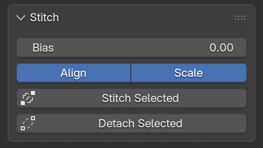

선택한 UV 엣지를 seam 건너편 아일랜드의 같은 엣지에 붙입니다.

1. 붙이려는 UV 엣지를 선택합니다. 여러 개를 함께 선택해도 됩니다.
2. Bias와 옵션을 정합니다.
3. **Stitch Selected**를 누릅니다.

Stitch Selected를 누른 직후에는 Blender 왼쪽 아래(또는 Edit → Adjust Last Operation)의 조정 패널에서 Bias, Align Clusters, Scale Clusters를 바꿔 결과를 보면서 다듬을 수 있습니다. 패널의 설정값은 바뀌지 않고, 누를 때마다 패널 값으로 다시 시작합니다.

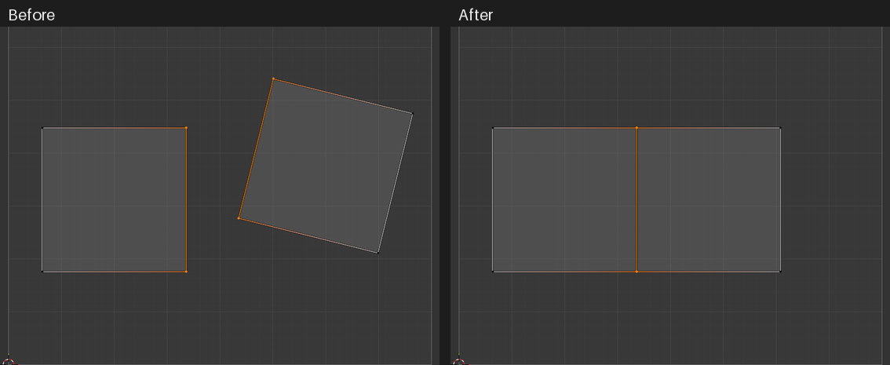

| 옵션 | 동작 |
|---|---|
| Bias 0 | 선택한 쪽 아일랜드는 그대로 두고, 이웃 아일랜드가 이동해 붙습니다. |
| Bias 1 | 이웃 아일랜드는 그대로 두고, 선택한 쪽이 이동해 붙습니다. |
| Bias 0.5 | 두 아일랜드가 서로 반씩 움직여 중간에서 만납니다. |
| Align (Align Clusters) | 움직이는 아일랜드를 돌려 엣지 방향을 맞춥니다. |
| Scale (Scale Clusters) | 움직이는 아일랜드의 크기를 바꿔 엣지 길이를 맞춥니다. |

보통은 Align과 Scale을 모두 켠 채로 사용합니다. 두 옵션을 끄거나 아일랜드의 모양이 서로 달라도(반듯하지 않은 사각형, 찌그러진 면 등) 이음선의 양 끝점은 마지막에 정확히 붙습니다.

- Align과 Scale을 켠 경우: 아일랜드를 돌리고 크기를 맞춘 뒤, 남는 작은 차이만 끝점에서 붙입니다. 아일랜드 모양이 가장 덜 변합니다.
- 끈 경우: 아일랜드는 이동만 하고, 이음선 끝점이 서로 붙으면서 그 부근의 모양이 늘어나거나 휩니다.

**어느 쪽이 "선택한 쪽"인가**

- 엣지의 한쪽만 선택되어 있으면 그쪽 아일랜드가 선택한 쪽입니다.
- 양쪽이 모두 선택되어 있으면(3D 뷰포트에서 엣지를 선택한 경우 등) 활성 면이 있는 아일랜드가 선택한 쪽으로 취급됩니다. 그대로 두고 싶은 아일랜드의 면을 마지막에 클릭해 두세요.

**알아둘 점**

- 같은 두 아일랜드 사이의 엣지를 여러 개 선택하면, 모든 엣지에 가장 잘 맞는 위치를 한 번에 계산합니다.
- 아일랜드 셋 이상을 연달아 붙이면, 먼저 붙은 아일랜드들이 한 덩어리로 함께 움직입니다.
- 이웃 아일랜드가 뒤집혀 있으면 자동으로 뒤집어서 붙입니다.
- 아일랜드들이 고리 모양으로 이어질 때 마지막 엣지는 아일랜드를 다시 옮기지 않고 끝점만 붙입니다. 그래서 그 부근이 조금 당겨질 수 있습니다.
- 붙인 뒤에도 메시의 seam 표시는 그대로 남습니다.

### Unstretch

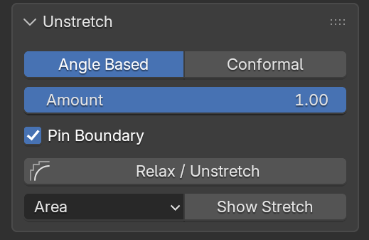

텍스처가 늘어나 보이는 UV를 바로잡습니다. 선택한 UV 정점의 위치를 3D 표면의 모양을 기준으로 다시 계산해서, 3D에서의 실제 비율에 가깝게 만듭니다.

1. 풀고 싶은 영역의 UV 정점을 선택합니다.
2. Method와 Amount를 정합니다.
3. **Relax / Unstretch**를 누릅니다.

Relax / Unstretch를 누른 직후에는 Blender 왼쪽 아래(또는 Edit → Adjust Last Operation)의 조정 패널에서 Method, Pin Boundary, Amount를 바꿔 결과를 보면서 다듬을 수 있습니다. 패널의 설정값은 바뀌지 않고, 누를 때마다 패널 값으로 다시 시작합니다.

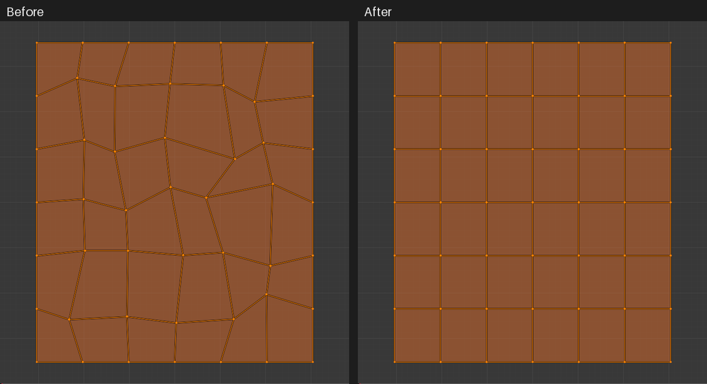

| 설정 | 동작 |
|---|---|
| Angle Based | 각도를 최대한 유지합니다. 대부분의 경우 이 방식이 무난합니다. |
| Conformal | 모양을 유지하지만 크기가 달라질 수 있습니다. |
| Amount | 풀린 결과 쪽으로 얼마나 움직일지 정합니다. 1이면 끝까지, 0.5면 절반만 움직입니다. |
| Pin Boundary (기본 켬) | 아일랜드 윤곽은 그대로 두고 안쪽 정점만 고르게 풉니다. 윤곽이 그대로라서 아일랜드의 모양과 위치가 달라지지 않고 이웃 아일랜드와 겹치지도 않습니다. 끄면 윤곽을 포함해 선택한 정점 전체를 풉니다. |

**Pin Boundary를 쓸 때 알아둘 점**

- 켜져 있으면 윤곽 위의 정점은 선택해도 움직이지 않습니다. 면이 하나뿐인 아일랜드처럼 모든 정점이 윤곽 위에 있으면 아무것도 바뀌지 않고 경고만 나옵니다.
- 윤곽이 이미 3D 표면의 비율과 다르게 찌그러져 있다면 Pin Boundary를 끄고 실행하세요. 켜 두면 윤곽이 그대로 고정되어 안쪽도 그 윤곽에 맞춰지므로, 오히려 왜곡이 커지기도 합니다.
- 끄면 아일랜드의 위치, 크기, 방향은 거의 그대로이고 모양만 풀립니다. 다만 모양이 크게 바뀌어 이웃 아일랜드와 겹칠 수 있고, 특히 Conformal은 변화가 커서 권하지 않습니다.

**그 밖에**

- 움직이지 않게 하고 싶은 정점에는 핀(P 키)을 찍어 두세요.
- 브러시처럼 문지르는 방식이 아니라, 버튼을 누를 때마다 한 번 계산합니다. 조금씩 풀고 싶으면 Amount를 낮춰서 여러 번 누르세요.

**Show Stretch**는 UV 에디터의 늘어짐 표시를 켜고 끕니다. 옆의 목록에서 Area(면적 왜곡)와 Angle(각도 왜곡) 중 무엇을 볼지 고릅니다. 파란색에 가까울수록 왜곡이 적습니다. UV 에디터가 하나 이상 열려 있어야 합니다.

### Connected Edges

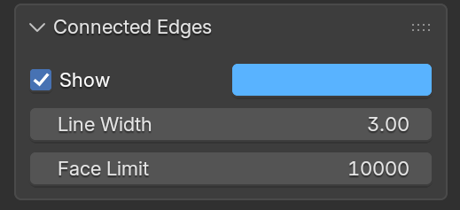

선택한 점·엣지·면이 다른 아일랜드의 어디로 이어지는지 UV 에디터에 색으로 표시합니다. seam으로 갈라진 반대편을 찾을 때 씁니다.

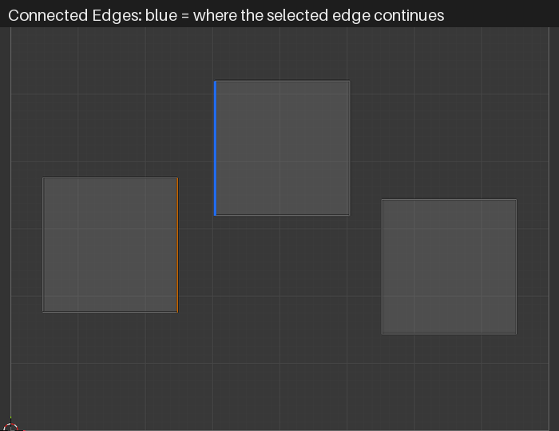

| 설정 | 동작 |
|---|---|
| Show | 표시를 켜고 끕니다. 기본은 켜짐입니다. 옆의 색 칸에서 표시 색을 바꿉니다. |
| Line Width | 선 굵기입니다. 점은 이보다 조금 크게 그려집니다. |
| Face Limit | Edit Mode의 면 수가 이 값을 넘으면 표시를 건너뜁니다. 기본값은 10,000입니다. |

- 정점 선택 모드에서는 점으로, 엣지·면 선택 모드에서는 선으로 표시합니다.
- 반대편이 이미 같은 위치에 붙어 있거나 반대편도 함께 선택되어 있으면 표시하지 않습니다.
- 이동·회전·크기 변경을 하는 동안에는 표시가 잠시 사라지고, 마우스를 놓으면 다시 나타납니다.
- 면이 많은 메시에서 UV 에디터가 느려지면 Face Limit을 낮추거나 표시를 끄세요.
- 면 수가 Face Limit을 넘어 표시를 건너뛰면 UV 에디터 왼쪽 위에 어느 표시가 빠졌는지 안내 문구가 나옵니다.

### About

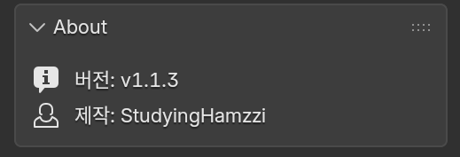

버전과 제작자를 확인할 수 있습니다.

## 작업 예시

### 아틀라스 정리하기

1. UV 에디터에서 A 키로 정리할 아일랜드를 모두 선택합니다.
2. Transform에서 **Auto H**를 눌러 아일랜드를 반듯하게 세웁니다.
3. Texel Density에서 Texture Size를 적고 **Equalize**를 눌러 밀도를 통일합니다.
4. Tile / Pack에서 U 0, V 0을 확인하고 Margin을 적은 뒤 **Pack into Tile**을 눌러 타일 안에 줄 맞춰 배치합니다.
5. 일부만 따로 손보려면 아일랜드를 선택해 Align Islands와 **Distribute U / V**로 다듬습니다.

### 갈라진 seam 붙이기

1. UV 에디터에서 붙이고 싶은 테두리 엣지를 선택합니다.
2. 파란 표시를 보고 짝이 되는 엣지가 어느 아일랜드에 있는지 확인합니다.
3. Stitch에서 Bias 0, Align과 Scale을 켠 상태로 **Stitch Selected**를 누릅니다.
4. 이음선이 맞물렸는지 확인합니다. 붙은 아일랜드는 하나로 합쳐지고, 이음선 끝점은 같은 위치에 놓입니다.

### 비뚤어진 엣지 펴기

1. 펴려는 엣지의 UV 정점을 선택합니다.
2. UV Vertices에서  버튼을 눌러 정점을 가로 일직선으로 만듭니다.
3. **Distribute U**를 눌러 정점 간격을 고르게 합니다.
4. 윤곽을 모두 맞췄으면 아일랜드 전체를 선택하고, Unstretch에서 **Relax / Unstretch**를 눌러 안쪽을 고르게 풉니다.

세로로 선 엣지는  버튼과 **Distribute V**를 사용합니다.

### 3D 모델 순서대로 정렬하기

1. 정렬할 아일랜드를 선택합니다(선택이 없으면 전체).
2. Distribute / Sort에서 기준 축(X, Y, Z)을 고릅니다.
3. **Sort U**(가로) 또는 **Sort V**(세로)를 누릅니다.
4. 타일 안에 담으려면 이어서 Tile / Pack의 **Pack into Tile**을 누릅니다.

### 여러 오브젝트의 텍셀 밀도 맞추기

1. 밀도를 맞출 오브젝트를 모두 선택하고 함께 Edit Mode에 들어갑니다.
2. 기준으로 삼을 면을 하나 클릭합니다. 이 면이 활성 면이 됩니다.
3. A 키로 전체를 선택합니다.
4. Texel Density에서 **Active**를 누르면, 모든 아일랜드가 기준 면이 속한 아일랜드의 밀도로 맞춰집니다.

### UDIM 타일로 나누기

1. 옮길 아일랜드를 선택합니다.
2. Tile / Pack에서 U, V에 타일 번호를 적습니다.
3. **Move to Tile**을 누릅니다.

## 경고 메시지와 문제 해결

도구를 실행하면 화면 아래 상태 표시줄(그리고 Info 창)에 나타나는 메시지입니다.

| 메시지 | 뜻과 해결 |
|---|---|
| No UV islands found | 처리할 아일랜드가 없습니다. UV 에디터 헤더의 UV Sync Selection 버튼(화살표 두 개 모양)이 꺼져 있으면 3D 뷰포트에서 선택한 면만 UV 에디터에 보입니다. 이때는 3D 뷰포트에서 면을 선택하세요. 아일랜드를 다루는 모든 도구가 같은 경고를 냅니다. |
| No UV map on (오브젝트 이름) - unwrap the mesh first (UV > Unwrap) | 그 오브젝트에 UV 맵이 없습니다(UV를 한 번도 펼치지 않은 메시). Blender에서 UV → Unwrap이나 Smart UV Project로 UV를 먼저 펼치세요. 이 경고가 나오면 아무것도 바뀌지 않습니다. |
| Skipped objects without a UV map: (오브젝트 이름) | 여러 오브젝트를 함께 편집할 때 UV 맵이 없는 오브젝트는 건너뛰고 나머지만 처리했다는 알림입니다. |
| Select at least two islands | Distribute와 Sort는 아일랜드가 두 개 이상 있어야 합니다. |
| The islands do not fit in one tile - enable Scale to Fit or lower the margin | Scale to Fit이 꺼져 있어서 아일랜드가 타일에 다 들어가지 않습니다. Scale to Fit을 켜거나 Margin을 줄이세요. |
| The margin is too large for this many islands - lower the margin | Scale to Fit이 켜져 있어도 Margin만으로 타일이 가득 찹니다. Margin을 줄이세요. |
| Select a UV edge inside the island | To Edge는 기준이 될 UV 엣지를 아일랜드 안에서 선택해야 합니다. |
| No measurable islands | 면적이 0인 아일랜드뿐입니다. UV가 한 점에 모여 있는지 확인하세요. |
| Target (px/m) must be above zero | Target에 0보다 큰 값을 적으세요. |
| No active face - select a face first | Active를 쓰려면 면을 하나 클릭해 활성 면으로 만드세요. |
| Select at least two UV vertices | 정점을 정렬하려면 두 개 이상 선택해야 합니다. |
| Select at least three UV vertices | 정점을 분배하려면 세 개 이상 선택해야 합니다. |
| Select UV edges that have a matching edge on another island | 선택한 엣지의 짝이 다른 아일랜드에 없습니다. seam이 아니거나 이미 붙어 있는 엣지입니다. |
| Select the UV vertices you want to relax | 풀려는 UV 정점을 선택하세요. |
| Only outline vertices are selected - select inner vertices or turn off Pin Boundary | 선택한 정점이 모두 아일랜드 윤곽 위에 있습니다. 안쪽 정점을 선택하거나 Pin Boundary를 끄세요. |
| Relax could not solve N island(s): they have no open UV border; they were left unchanged | UV에 열린 경계가 없는 아일랜드입니다(모든 엣지가 붙어 있음). 풀 수 없어서 그대로 두었습니다. seam을 만들어 UV를 한 곳 이상 갈라서 열린 경계를 만든 뒤 다시 시도하세요. |
| Relax could not solve N island(s); they were left unchanged | 풀기에 실패한 아일랜드는 그대로 두었습니다. 선택 범위를 줄이거나 아일랜드를 나눠서 다시 시도하세요. |
| Relax failed | Blender의 펼치기 계산이 실패했습니다. 선택 범위를 줄여서 다시 시도하세요. |
| Could not restore selection / seams / pins on (오브젝트 이름) - press Ctrl+Z | Relax가 끝난 뒤 그 오브젝트의 선택, seam, 핀을 원래대로 돌리지 못했습니다. Ctrl+Z로 되돌린 뒤 다시 시도하세요. |
| No UV editor is open | Show Stretch는 UV 에디터가 열려 있어야 합니다. |

| 증상 | 확인할 것 |
|---|---|
| Hamzzi UV Toolkit 탭이 없다 | 메시가 Edit Mode인지, 애드온이 Preferences에서 켜져 있는지 확인하세요. |
| 패널의 햄스터 그림이 안 보인다 | 설치용 zip의 `images` 폴더에 `logo.png`와 `mascot.png`가 들어 있는지 확인하세요. 그림이 없어도 기능은 동작합니다. |
| 버튼이 회색이다 | Edit Mode의 메시 오브젝트가 있는지 확인하세요. Scale 버튼은 U, V 배율이 모두 1이면 비활성화됩니다. |
| 선택한 것보다 많이 움직인다 | 아일랜드 도구는 정점 하나만 선택해도 그 정점이 속한 아일랜드 전체를 움직입니다. 선택이 없으면 보이는 아일랜드 전체에 적용됩니다. |
| 밀도를 맞췄더니 아일랜드가 겹친다 | 정상 동작입니다. 밀도를 맞추면 아일랜드가 제자리에서 커지거나 작아지기 때문입니다. Pack into Tile이나 Blender의 Pack Islands로 다시 배치하세요. |
| Relax한 뒤 아일랜드가 이웃과 겹친다 | Pin Boundary를 끄고 풀었을 때 생길 수 있습니다. Pin Boundary를 켜면 윤곽이 그대로라서 겹치지 않습니다. |
| 뒤집힌 면이 칠해지지 않는다 | Transform 패널의 Show Flipped가 켜져 있는지, UV 에디터가 열려 있는지, 면 수가 Face Limit을 넘지 않는지 확인하세요. 숨긴 면은 검사하지 않습니다. |
| Connected Edges가 보이지 않는다 | 표시가 켜져 있는지, 면 수가 Face Limit을 넘지 않는지 확인하세요. 선택한 엣지의 반대편이 이미 붙어 있으면 표시되지 않습니다. |
| UV 에디터에서 끌 때 느리거나 Blender가 멈춘다 | Connected Edges의 Show를 끄고 다시 시도하세요. 계속되면 저장소의 Issues에 알려 주세요. |
| 패널이 이전 버전 모습이다 | 새 zip을 설치한 뒤 Blender를 다시 시작하세요. |

## 알려진 한계

- Stitch는 선택한 엣지에만 동작하며, 가까운 엣지를 자동으로 찾아 붙이지는 않습니다.
- Unstretch는 브러시가 아니라 선택 영역에 한 번에 적용됩니다.
- 구처럼 평평하게 펼 수 없는 형태를 강제로 펴는 기능은 아직 없습니다.
- Pack into Tile은 아일랜드의 경계 상자를 기준으로 배치하고 회전하지 않습니다.
- 밀도를 바꿔도 아일랜드를 자동으로 다시 배치하지 않습니다.
- Connected Edges는 면이 Face Limit을 넘으면 표시를 건너뜁니다.
- 패널의 버튼 이름은 영어입니다.
